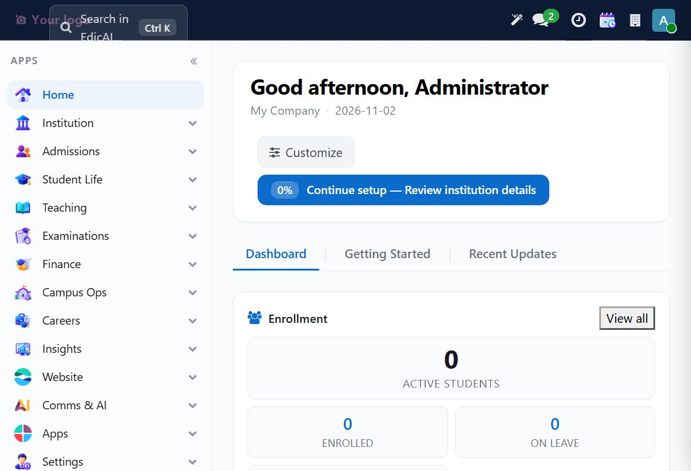
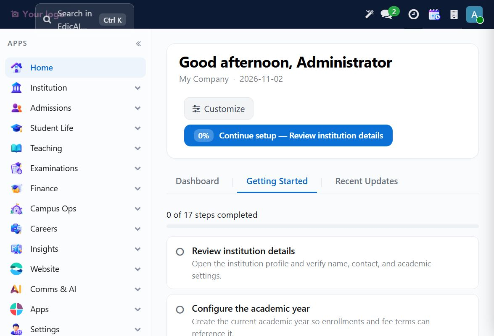

# 1. Getting Started — Login & Orientation

## 1.1 Logging in

1. Open the Edicai URL provided by your administrator. The original walkthrough used an isolated UAT URL (`http://127.0.0.1:18071`), which is not a public documentation address.
2. Enter your username and password.
3. Sign in using the credentials issued for your environment. If a freshly initialized test installation still uses an insecure default password, change it immediately; never reuse test credentials in production.

You land on the **Home workspace**.

## 1.2 Reading the Home screen

| Area | What it shows |
|---|---|
| **Left sidebar** | The 13 Edicai workspaces with 3D icons. Click a workspace to expand its menus; click again to jump in. |
| **Top bar** | Search (Ctrl+K), Messages, Activities, Calendar, and your avatar menu. |
| **Greeting card** | Your name, the company, and today's date. The **Continue setup** button opens the onboarding checklist. |
| **Dashboard / Getting Started / Recent Updates** | Three tabs: KPI cards, the guided setup checklist, and recent record changes. |
| **Enrollment card** | Live counts of active students, enrolled, and on leave. |

> 💡 The dashboard is customizable — click **Customize dashboard** to choose which KPI blocks you see.

## 1.3 Optional demo checklist (17 steps)

The **Getting Started** tab is an optional demo/onboarding aid, **not the implementation path for this administrator guide**. Click **Continue setup — Review institution details** only if you want to inspect that checklist. It tracks your setup progress ("0 of 17 steps completed") and links directly to each task.

The 17 steps, in order:

| # | Step | Covered in |
|---|---|---|
| 1 | Review institution details | [Module 2](02_settings_institution.md) |
| 2 | Configure the academic year | [Module 3](03_teaching_calendar.md) |
| 3 | Schedule the running semester | [Module 3](03_teaching_calendar.md) |
| 4 | Review user roles and permissions | [Module 2](02_settings_institution.md) |
| 5 | Explore key Edicai modules | [Module 1](01_getting_started.md) (below) |
| 6 | Find your assigned classes | [Module 3](03_teaching_calendar.md) |
| 7 | Learn the attendance workflow | [Module 4] |
| 8 | Grade an assignment submission | [Module 3](03_teaching_calendar.md) |
| 9 | Review the fee invoice workflow | [Module 6] |
| 10 | Record and confirm payments | [Module 6] |
| 11 | Set up a placement drive | [Module 9] |
| 12 | Review discipline workflow | [Module 4] |
| 13 | Understand the admissions pipeline | [Module 5] |
| 14 | Learn the application review workflow | [Module 5] |
| 15 | Set up follow-ups for inquiries | [Module 5] |
| 16 | Manage a book issue and return | [Module 4] |
| 17 | Publish a notice | [Module 11] |

For operational setup, skip this checklist and continue with Chapter 2. Each checklist card can be **Mark done** (manually) or **Skip**-ped. Many steps tick themselves automatically when you complete the underlying action.

## 1.4 Orientation drill (Step 5 — Explore key modules)

Do this once as a new admin — it takes 10 minutes and pays off forever:

1. Click each workspace in the sidebar and glance at its menus.
2. Notice the pattern every list follows: **New** button top-left, search/filter bar above the list, and a record opens as a form when clicked.
3. Practice keyboard shortcuts: `Ctrl+K` opens global search; `Esc` closes dialogs.

> ✅ **You're ready to configure the institution.** Continue to [Module 2 — Settings, Institution Setup, Users & Roles](02_settings_institution.md).
