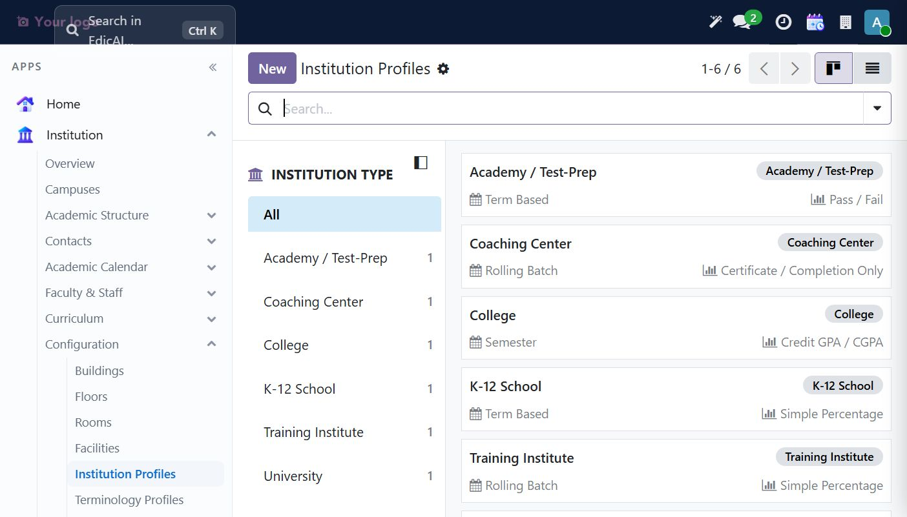
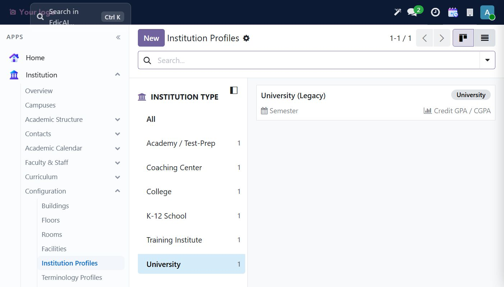
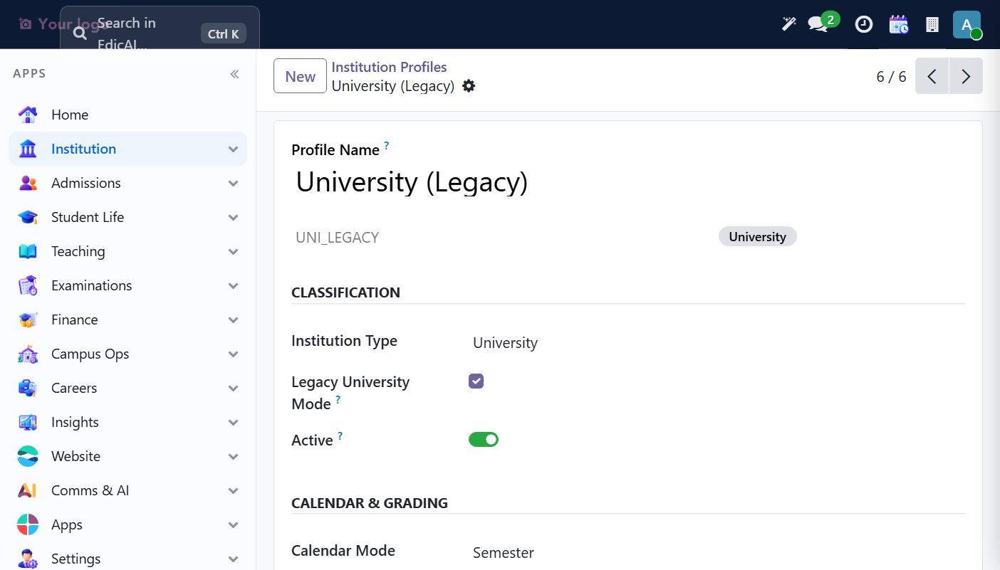
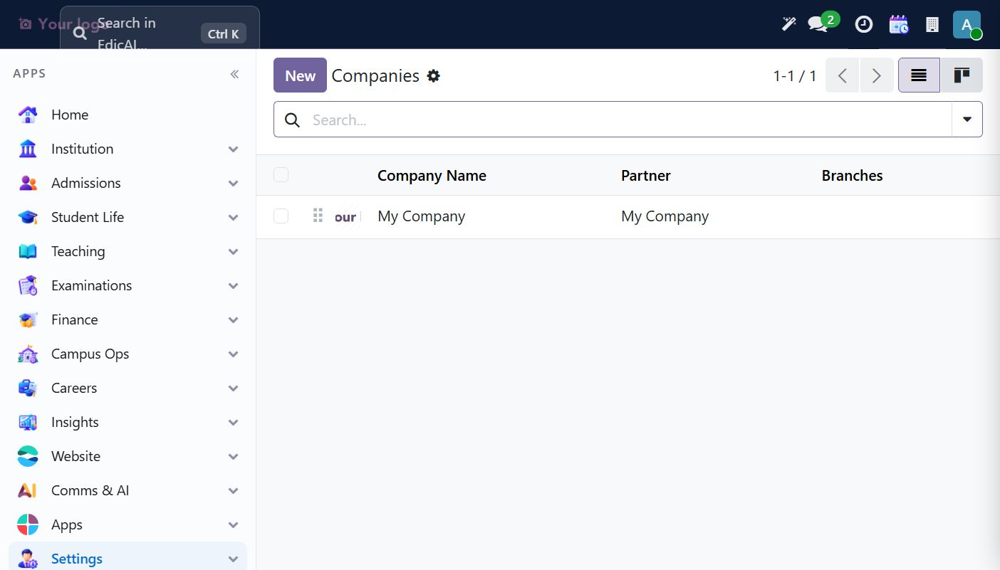
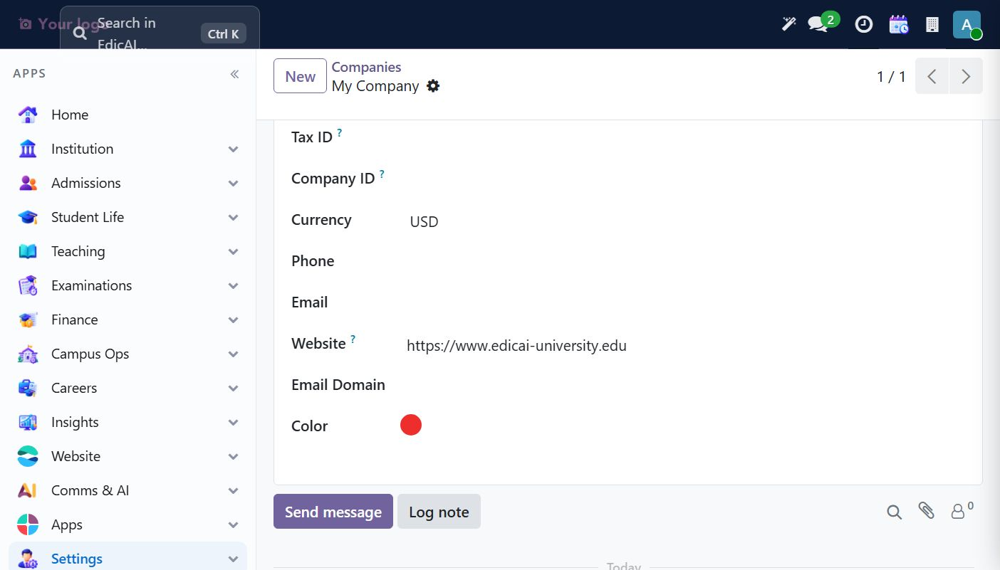
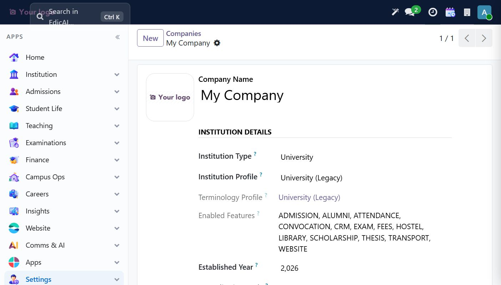
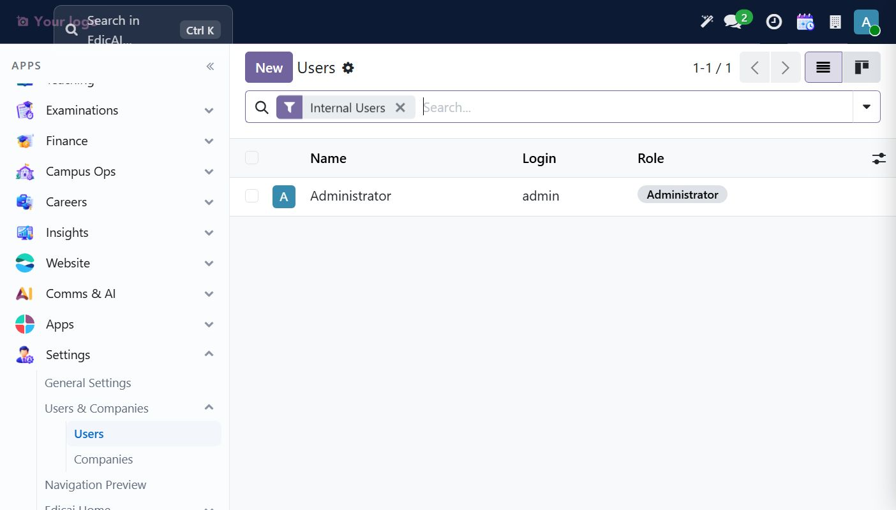
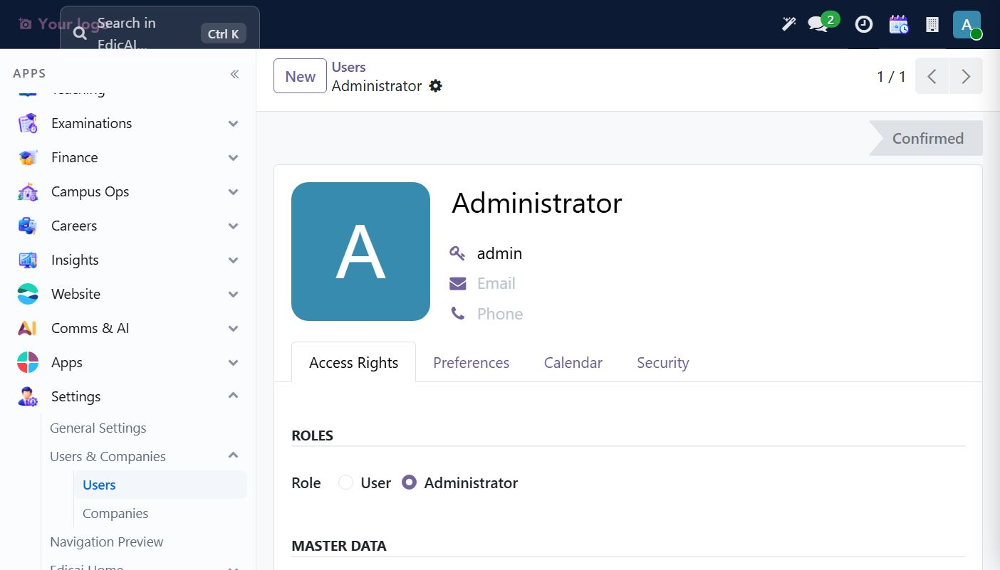

# 2. Settings — Institution Setup, Users & Roles

This chapter documents institution setup and user roles directly; using the demo onboarding checklist is optional.

## 2.1 Institution Profiles (templates)

First stop: **Institution → Configuration → Institution Profiles**.

Edicai ships one profile per institution type. On a fresh database you will see six templates:

Use the left **Institution Type** filter to jump to the relevant group (e.g., University shows the `University (Legacy)` profile with *Semester* calendar and *Credit GPA/CGPA* grading):

Open a profile to check its **Classification** (Institution Type, Legacy mode, Active flag) and **Calendar & Grading** settings:

> 💡 These are **templates**. You normally don't create new ones — you *link your company* to the matching template in the next step.

## 2.2 The institution (company) record

Go to **Settings → Users & Companies → Companies**:

Open **My Company** (the default company on a fresh install). The form has a dedicated **Institution Details** section that drives behaviour across the whole product — it controls terminology (do you say *Faculty* or *Department*, *Semester* or *Term*), enabled feature areas, grading defaults and more:

### Edit the institution details

1. The form opens in edit mode (the toolbar shows **Save (cloud icon)** and **Discard (X)** instead of Edit).
2. Set **Institution Type** — typing in the field opens a suggestion popover: *University, College, School, Training Institute, Online Academy*. Pick the one that matches your institution. The dropdown is what you'd see while typing:

3. Fill contact basics further down: **Website**, **Phone**, **Email**, and the address block (Street, City, ZIP, Country).
4. Set **Established Year** (integer field).
5. Click the **Save** (cloud) icon in the top bar. A *"Saved"* flash confirms it.

### What saves look like

After saving, the record returns to read-only display. Verify **Institution Type = University**, **Institution Profile = University (Legacy)**, **Terminology Profile**, the **Enabled Features** list (ADMISSION, ALUMNI, ATTENDANCE, CONVOCATION, CRM, EXAM, FEES, HOSTEL, LIBRARY, SCHOLARSHIP, THESIS, TRANSPORT, WEBSITE), and **Established Year**:

> ⚠️ **Watch out (Odoo behaviour):** pressing **Esc** while a form is in edit mode *discards all unsaved changes*. To close a dropdown without picking, click elsewhere instead.

## 2.3 Users and Edicai roles

Go to **Settings → Users & Companies → Users**. On a fresh install there is one internal user — **Administrator**:

Note the **Role** column — a custom Edicai field, separate from Odoo's access rights.

Open the user to see the detail form. Key areas for admins:

- **ROLES** — the Edicai role radio: `User` vs `Administrator`. This drives Edicai-scoped permissions (e.g., who can approve admissions or reset fee data).
- Tabs: **Access Rights** (Odoo standard groups), **Preferences**, **Calendar**, and a custom **Security** tab (passkeys / ToTP).

### Creating a staff account (Registrar example)

1. Click **New**.
2. Fill **Name**, **Email Address** (login), and set **Role** per job function.
3. Under **Access Rights → Administration**, avoid giving *Settings* unless the person administers the system itself.
4. **Send Invitation Email** can email an invitation when outbound email is configured and permitted. In an isolated test environment with outbound email disabled, use an approved offline account-activation method instead.
5. Save.

Edicai's functional groups live under the *Technical* → groups registry: **Registrar**, **Finance**, **Faculty** — combine *Role* with Odoo groups when in doubt: Role = what they see in Edicai, Groups = what Odoo allows.

> ✅ **Verification:** Confirm the institution details were saved and the administrator's access rights are correct.
>
> Next: [Chapter 3 — Academic Calendar](03_teaching_calendar.md).
