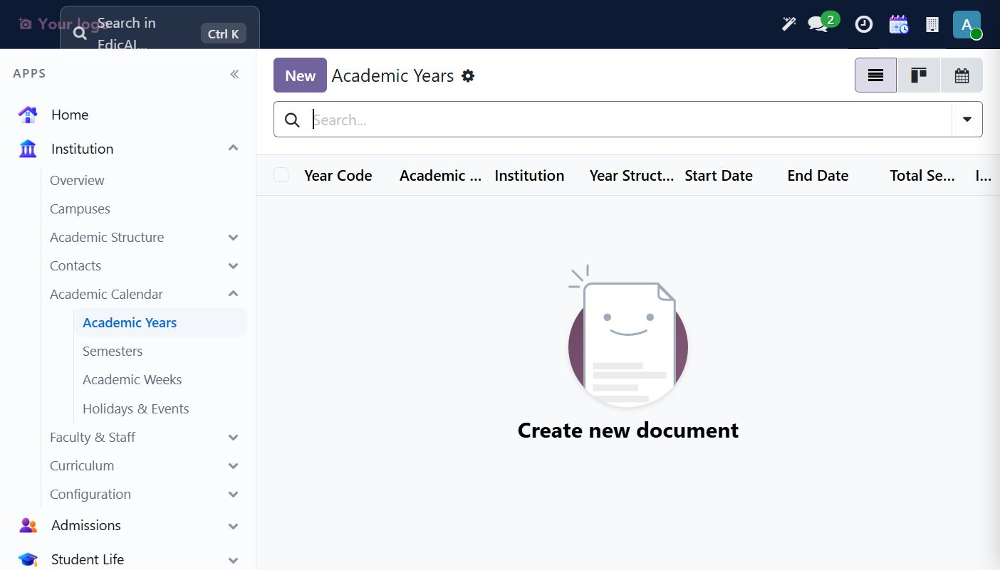
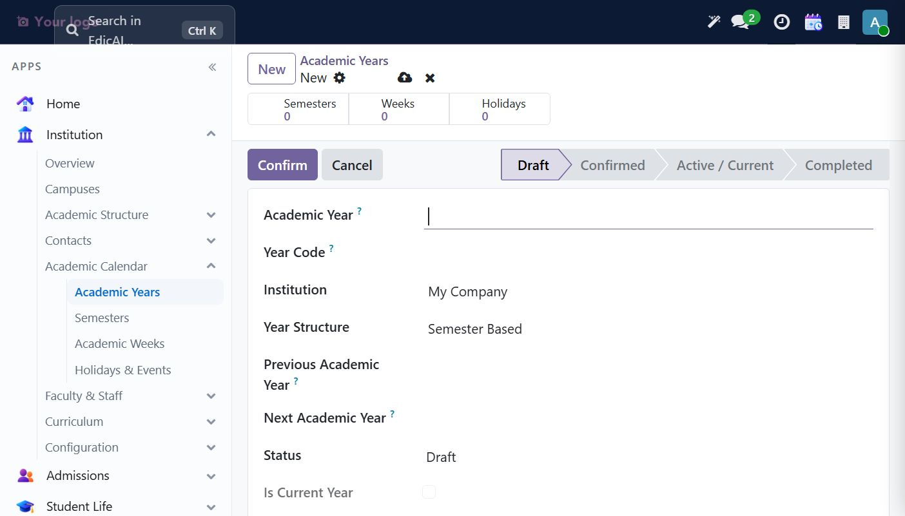
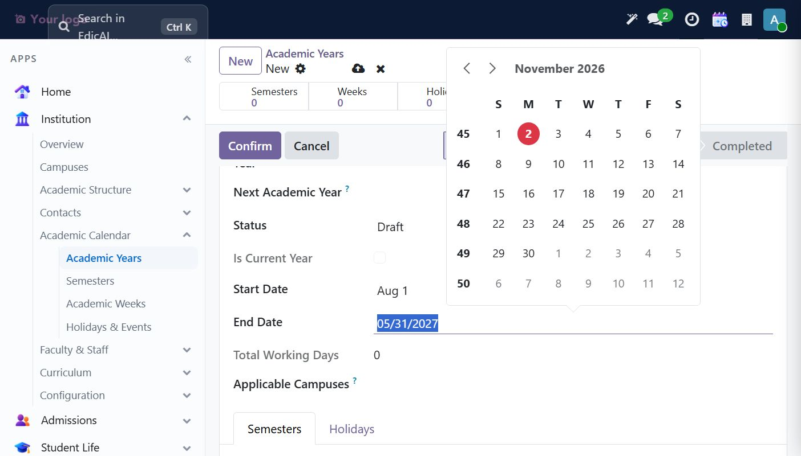
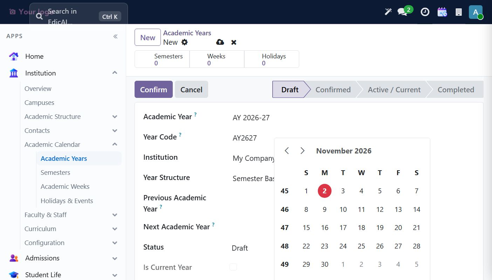
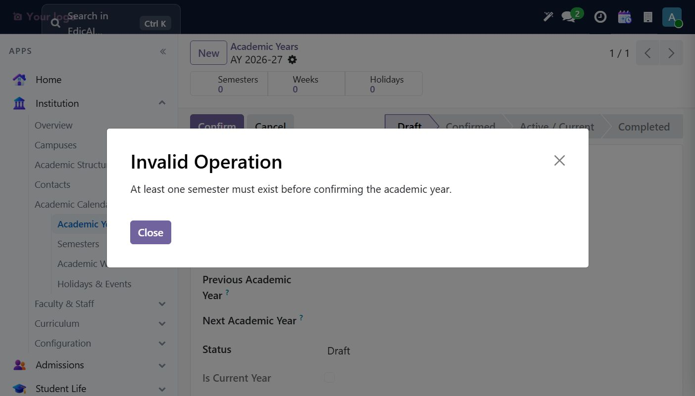
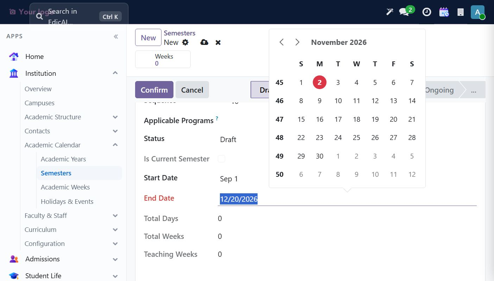
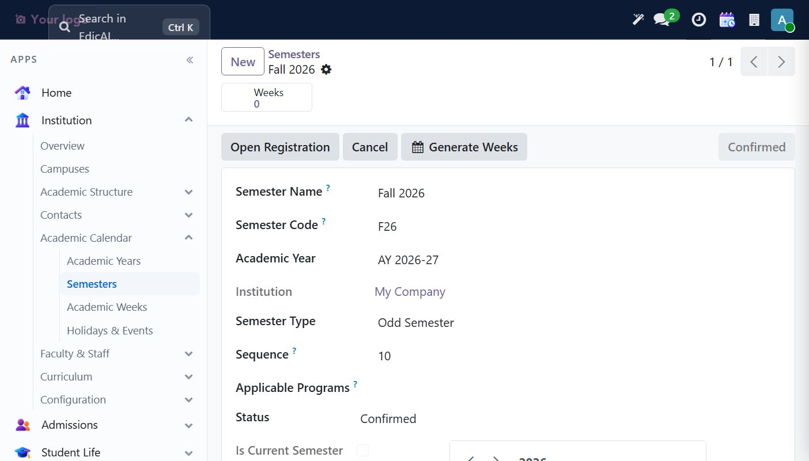
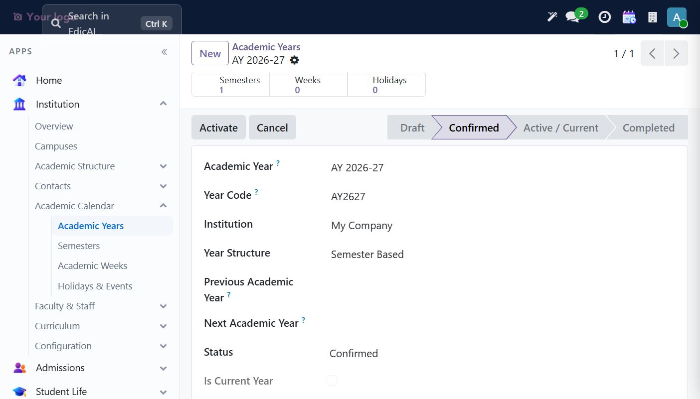
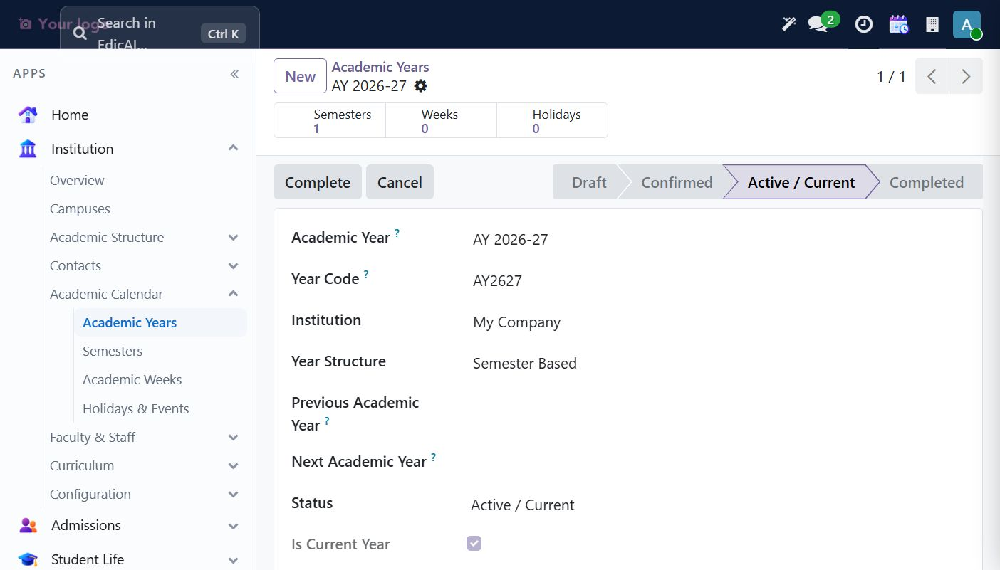

# 3. Teaching — Academic Calendar: Years, Semesters & Setup

This chapter provides the operational setup sequence; it does not require completing the demo onboarding checklist.

Navigation: **Institution → Academic Calendar** — it bundles *Academic Years, Semesters, Academic Weeks, Holidays & Events*.

## 3.1 Create the Academic Year

Go to **Institution → Academic Calendar → Academic Years**. An empty list shows the friendly *"Create new document"* empty state:

Click **New**. The form opens in **Draft** with the full status pipeline visible: `Draft → Confirmed → Active / Current → Completed`:

Fill in:

| Field | Example value | Notes |
|---|---|---|
| Academic Year | `AY 2026-27` | Human-readable name |
| Year Code | `AY2627` | Short code used in reports |
| Institution | *My Company* | Defaults automatically |
| Year Structure | `Semester Based` | Drives how the calendar is modeled |

Then set **Start Date** and **End Date** — click the field to open the date picker, navigate months with the arrows, and click the day:

A filled Draft after typing — notice the confirmation didn't happen yet:

### Confirming — and the guard rail you'll hit

Click **Confirm** (button above the form). On a fresh year you will get this popup:

> **Invalid Operation** — *At least one semester must exist before confirming the academic year.*

That's by design — Odoo-style constraint preventing a "live" year with no terms in it. Create the semester first (below), then come back and **Confirm** will succeed.

## 3.2 Create the Semester

Go to **Academic Calendar → Semesters → New**. The semester form carries a lot of operational data — name/code, the parent academic year, dates, registration windows and exam periods:

| Field | Example |
|---|---|
| Semester Name | `Fall 2026` |
| Semester Code | `F26` |
| Academic Year | `AY 2026-27` *(pick from autocomplete)* |
| Semester Type | `Odd Semester` (default) |
| Sequence | `10` |
| Start Date | `09/01/2026` |
| End Date | `12/20/2026` |

> 💡 **KEY DATES** section (Registration Opens/Closes, Add/Drop Deadline, Withdrawal Deadline, Exam Period Start/End, Result Declaration Date) drives what students can self-service during the term. Filling **Registration Opens** by accident while exploring? Just set it to the date you want (or leave blank) — it's editable any time.

Click **Confirm** → the semester is saved and the workflow buttons change to **Open Registration** and **Generate Weeks**:

- **Open Registration** — flips the semester into its registration window state.
- **Generate Weeks** — creates weekly academic-week rows used by timetables and attendance aggregation.

## 3.3 Confirm & Activate the Academic Year

Now that a semester exists, open the Academic Year and click **Confirm** — this time it passes, and the smart-buttons show **Semesters: 1**:

Click **Activate** to make it the institution's current year — `Is Current Year` ticks automatically and Status shows **Active / Current**:

> ✅ **Verification:** The academic year is Active / Current and contains a Confirmed semester.
>
> **Rule of thumb:** *Semesters live inside years, sections live inside semesters — always create top-down.*
>
> Next, to finish the Teaching picture: create Faculties/Programs/Courses (continue to the *Teaching* workspace walkthrough) — the next sections of this guide.
