# 4. Teaching — Academic Structure (Faculties → Departments → Programs)

Navigation: **Institution → Academic Structure** (`Faculties`, `Departments`, `Programs`, `Specialisations`).

> 🧭 **The dependency chain is enforced by the system** — Edicai refuses to activate a level until the level below it exists. The setup order is exactly:
> **Campus → Building → Faculty → Department → Program**

## 4.1 Create the Faculty

**Institution → Academic Structure → Faculties → New.**

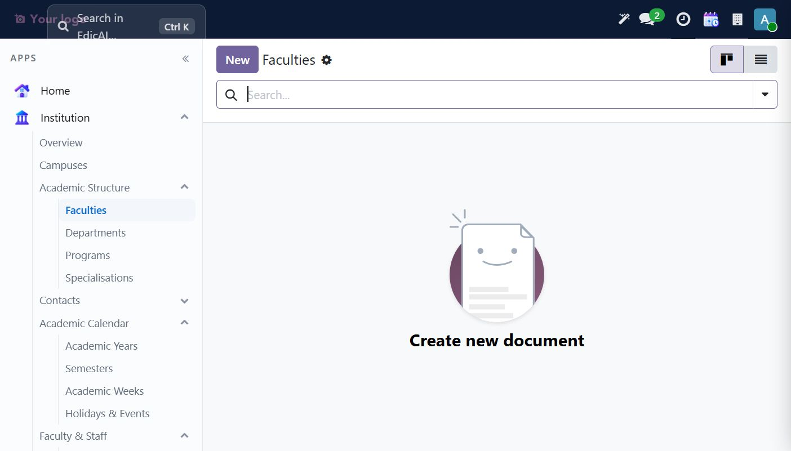

Form fields for our example `Faculty of Engineering` (`ENG`, Established 2001):

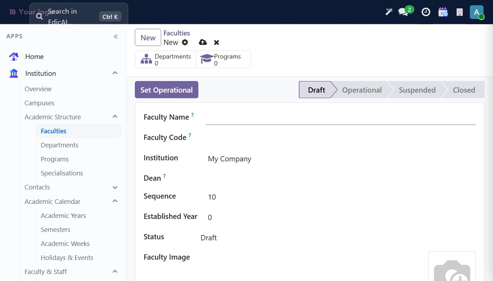

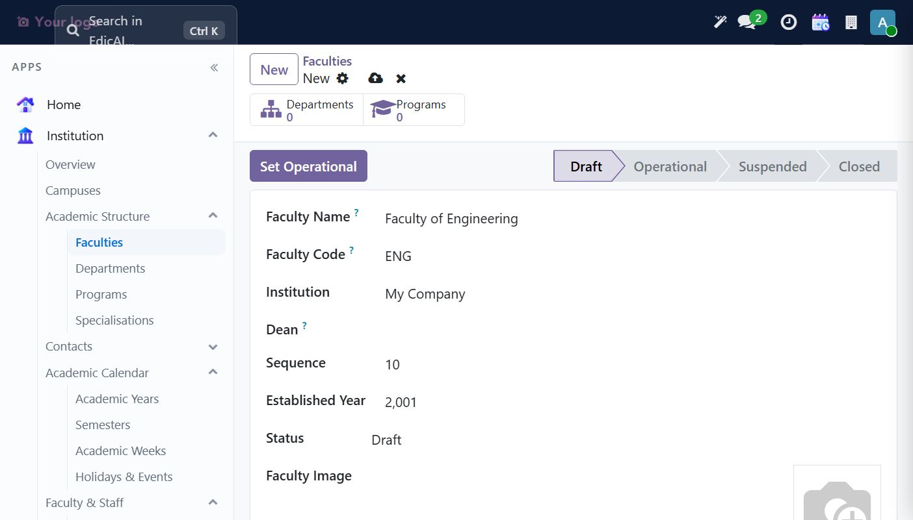

Workflow is `Draft → Operational → Suspended → Closed`, driven by the **Set Operational** button.

### Guard rail #1

Clicking **Set Operational** on an empty faculty triggers:

> *You must add at least one department before setting the faculty to Operational.*

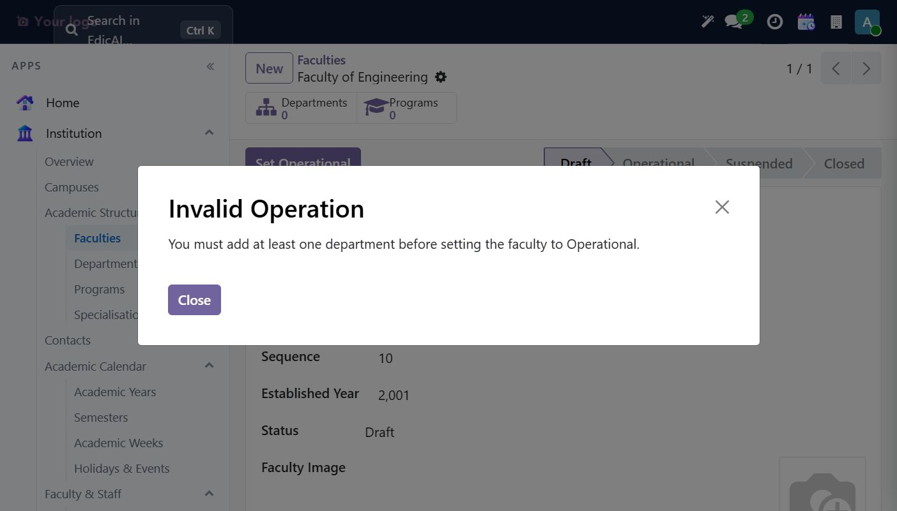

Smart buttons at the top give quick counts — **Departments** and **Programs** link to the filtered lists:

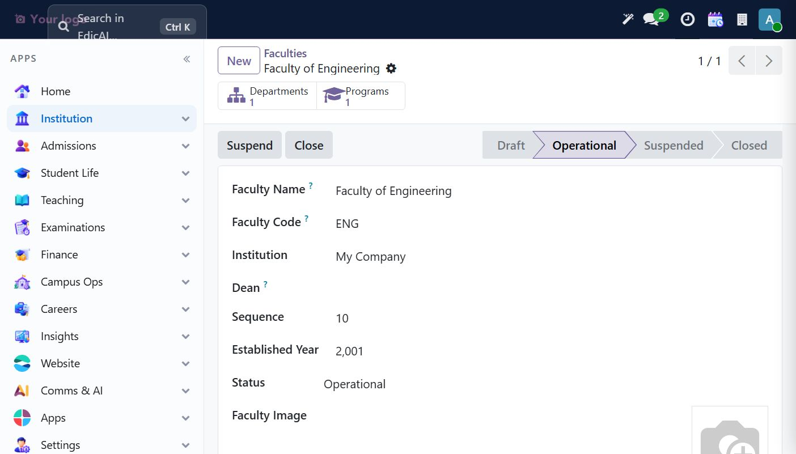

## 4.2 Create the Department

**Institution → Academic Structure → Departments → New.**

| Field | Example |
|---|---|
| Department Name | `Computer Science` |
| Department Code | `CSE` |
| Faculty | `Faculty of Engineering` *(autocomplete)* |
| Head of Department | pick a faculty member (later) |

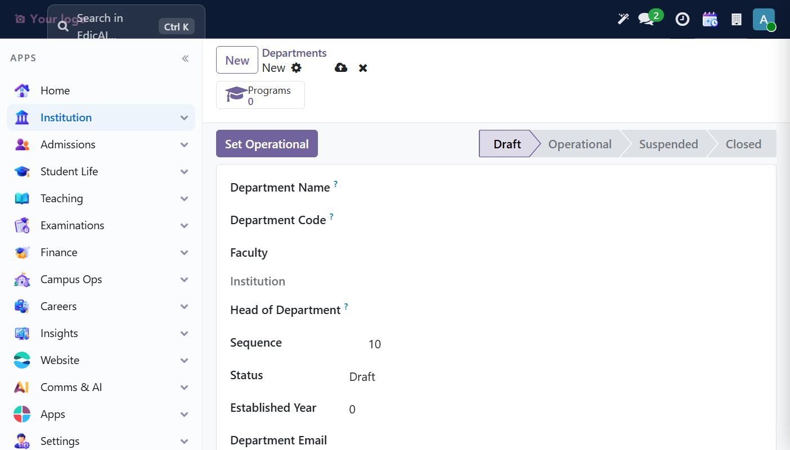

### Guard rail #2

**Set Operational** needs at least one **Program**:

> *You must add at least one program before setting the department to Operational.*

## 4.3 Create a Campus (needed before the program activates)

**Institution → Campuses → New** — Campus Name `Main Campus`, Code `MC`, Campus Type `Main Campus`, Student Capacity `5000`, tick **Is Main Campus**.

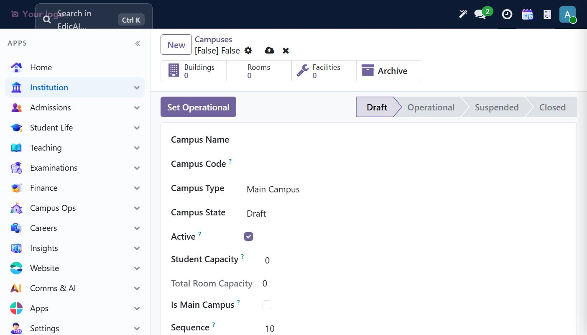

> ⚠️ TIP: on an unsaved new record the breadcrumb shows `[False] False` — a cosmetic quirk; after save it becomes the proper `[MC] Main Campus`.
>
> The campus itself also has the Draft → Operational chain, and needs ≥1 Building: create one via the **Buildings** smart button (`Engineering Block`, code `EB` — the building form auto-fills the Campus!). See building form: [image](images/34_building_form.jpeg).

Once the building exists, **Set Operational** flips the campus into live state with `Suspend` / `Close` buttons:

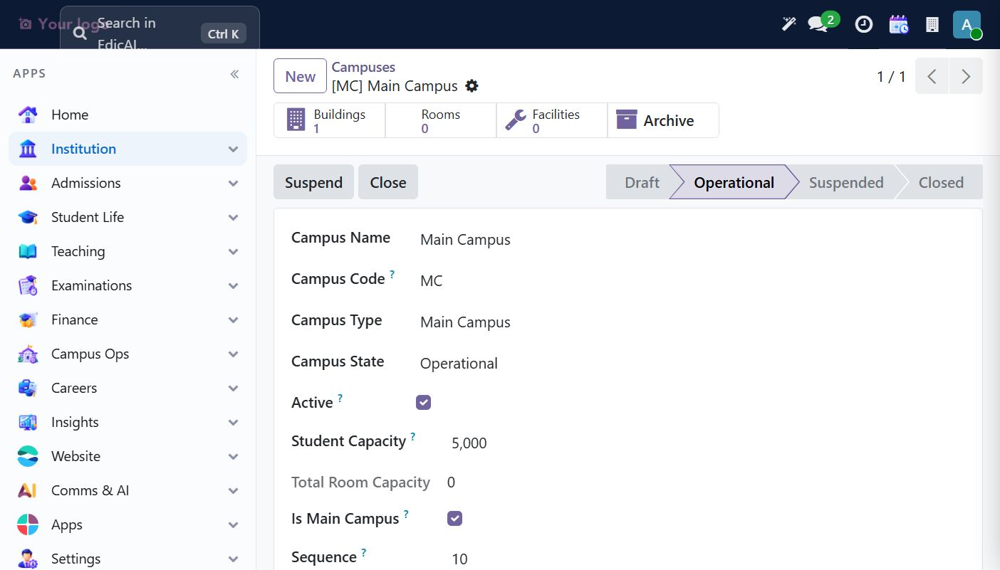

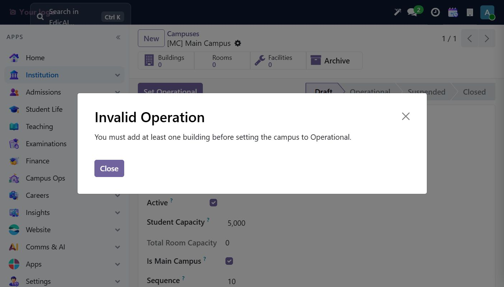

## 4.4 Create the Program

**Institution → Academic Structure → Programs → New** — the richest setup form:

| Field | Example |
|---|---|
| Program Name | `B.Tech Computer Science` |
| Program Code | `BTCS` |
| Degree Title | `Bachelor of Technology (Computer Science)` |
| Department | `Computer Science` *(Faculty auto-fills)* |
| Duration | `4.0` years — **Automatically yields 8 semesters** |
| Program Type | `Undergraduate` |
| Total Credits Required | `120` |

Workflow: `Draft → Approved → Active → Discontinued`.

On save, Edicai explains the derived structure:

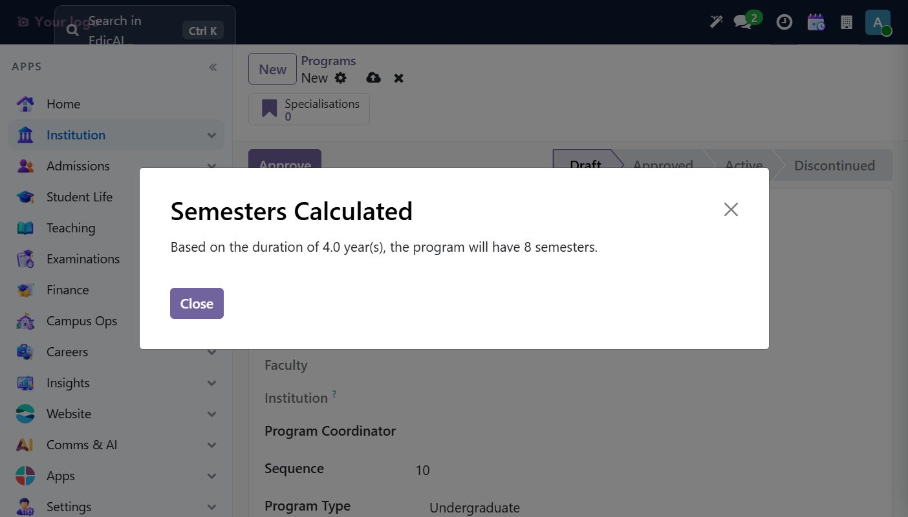

### Guard rail #3 — campus required

**Activate** refuses until a campus is assigned:

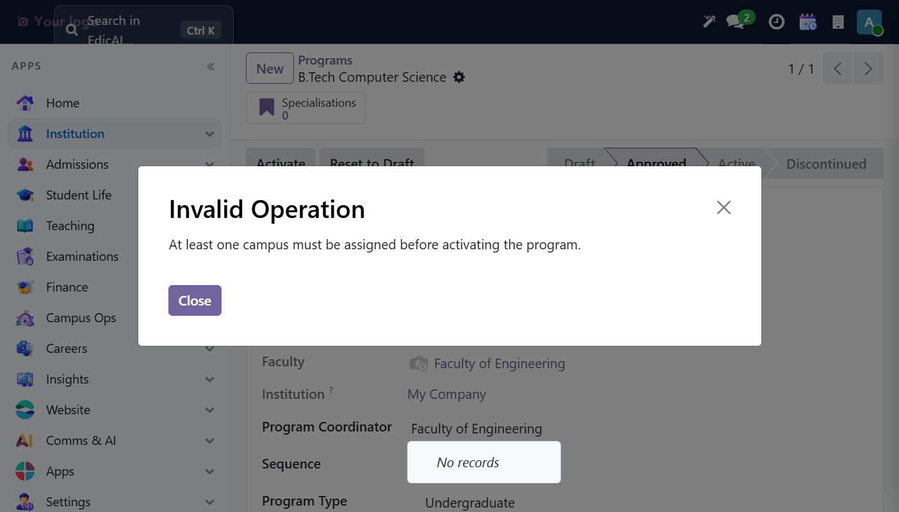

Fix: edit **Offered at Campuses** (tag widget) and add `[MC] Main Campus`:

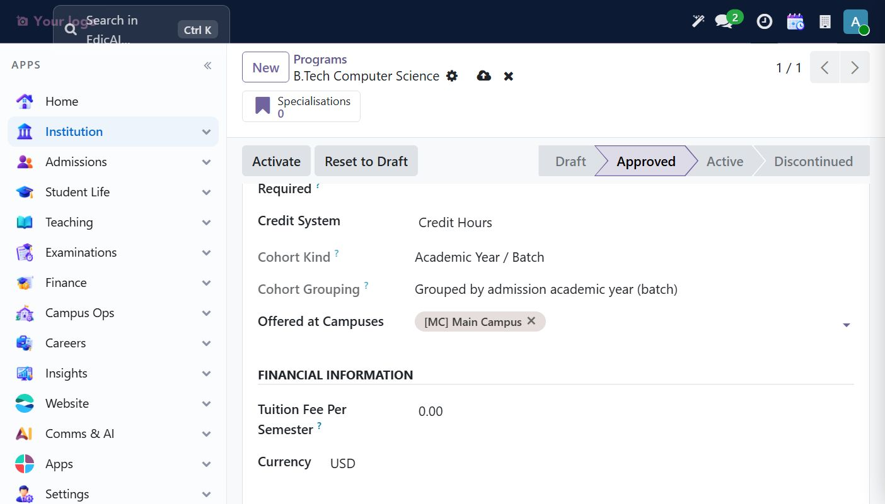

Then **Activate** → program is live.

## 4.5 Finish the chain & verify in Overview

Return to the Department and Faculty and click **Set Operational** on each — the guards pass now.

Open **Institution → Overview**: the KPI cards now count your setup (Campuses 1 · Programs 1), each with free drill-down on click, filterable by Institution/Campus, aggregating live via `read_group`:

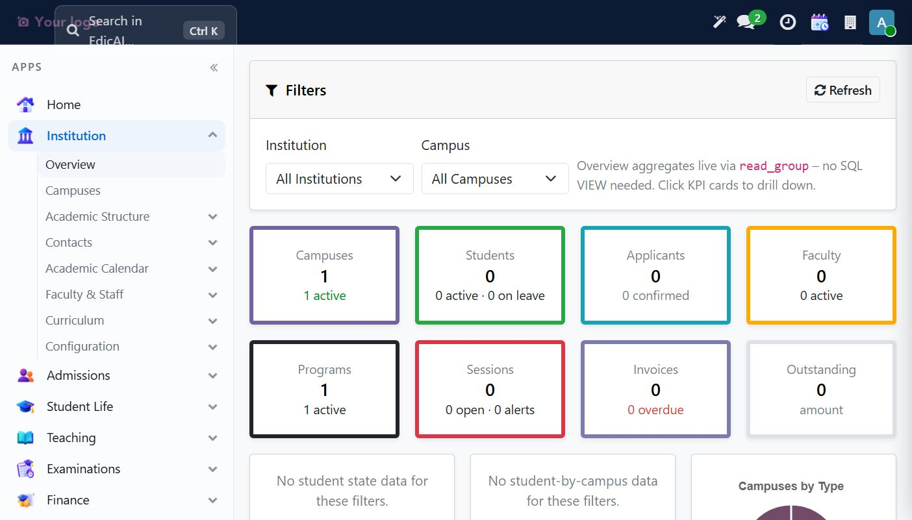

The pie chart at the bottom already breaks down Campuses by Type.

> ✅ **Setup chain complete.** Students/admissions in the next chapter depend on an *active program + operational department/faculty + semesters* — all done now.
