# 8. Examinations — Schedules, Hall Tickets, Grading & Results

Navigation: **Examinations** for exam schedules and tickets; **Grading** for grade entries, verification and semester results. Before this module, make sure the course, academic offering, enrolled student and grade scale are ready.

This walkthrough uses the UAT sample records: **Data Structures (`CS301`)**, **B.Tech Computer Science**, **Fall 2026**, **Main Campus**, instructor **Meera Iyer**, and student **Aarav Sharma**.

## 8.1 Prepare the offering and class roster

An exam is attached to a course offering, and exam tickets are issued to students registered in that offering. Start in **Institution → Academic Structure → Course Offerings** (or the offering list in the Institution workspace).

If you are setting up a new department, create the instructor in **Institution → Faculty & Staff** and the course in **Institution → Academic Structure → Courses** first. The instructor and course must be active before they can be assigned to an offering.

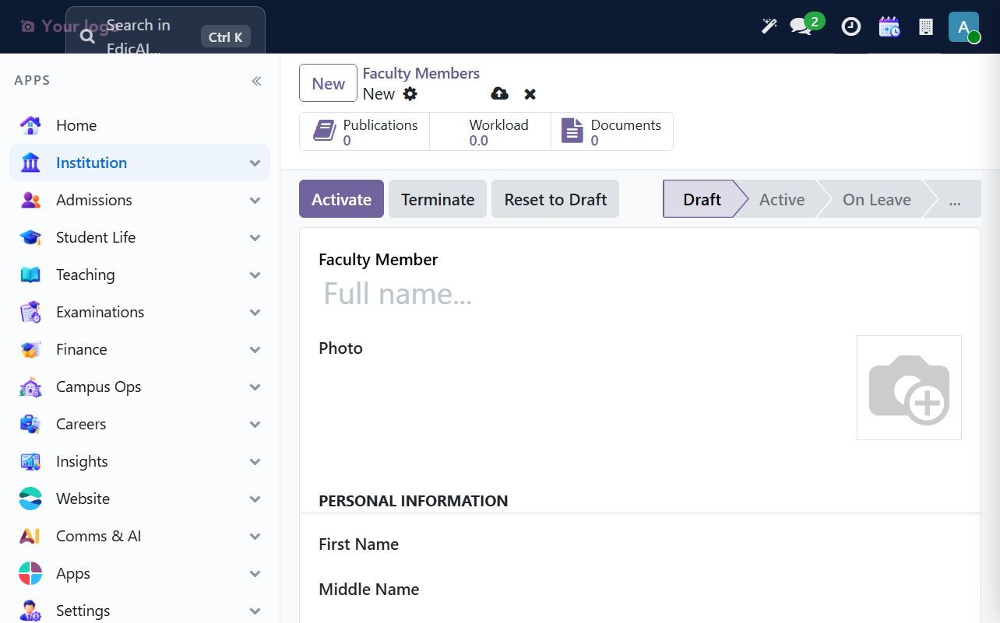

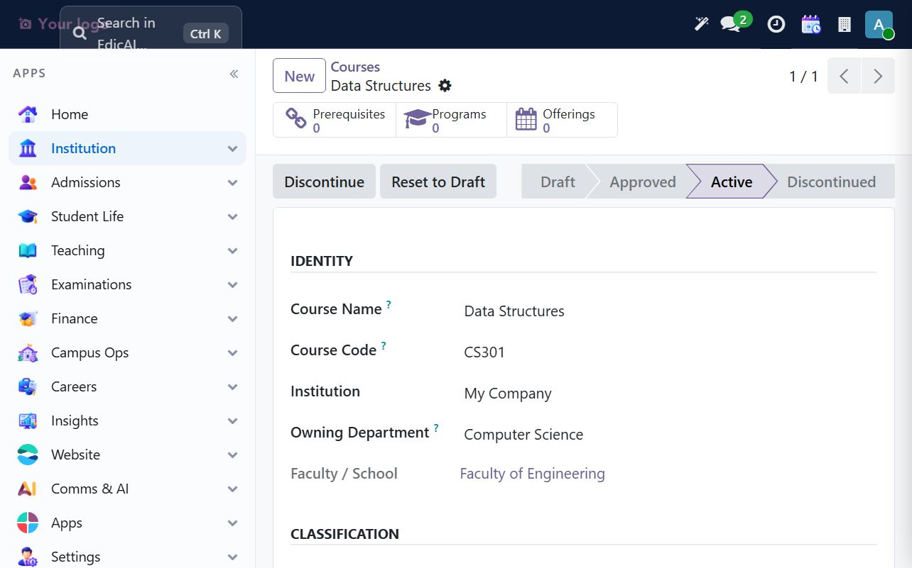

The sample offering is `CS301 / F26 / A`: program semester 3, Section A, 4 credits, AY 2026-27, Fall 2026, Main Campus, instructor Meera Iyer, maximum enrollment 60. The offering must be **Open for Enrollment** before registering students.

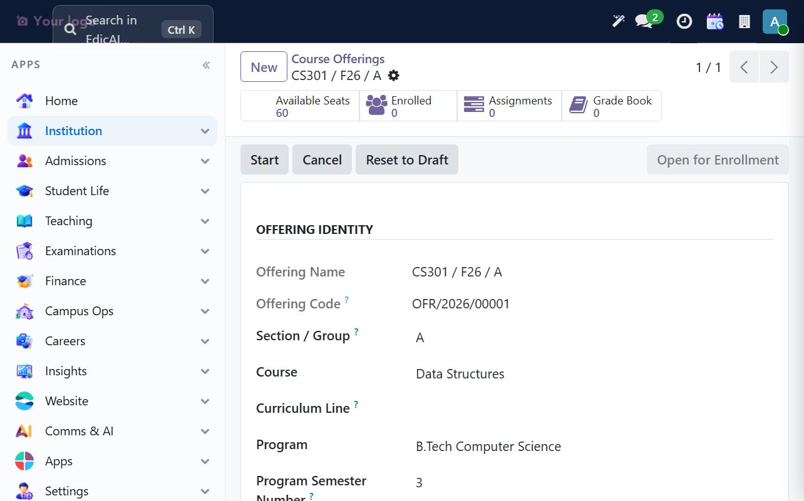

Open the offering's **Enrolled** smart button and choose **New**. Select the student and save. The course, semester and campus are derived from the offering; the resulting enrollment is `Registered`.

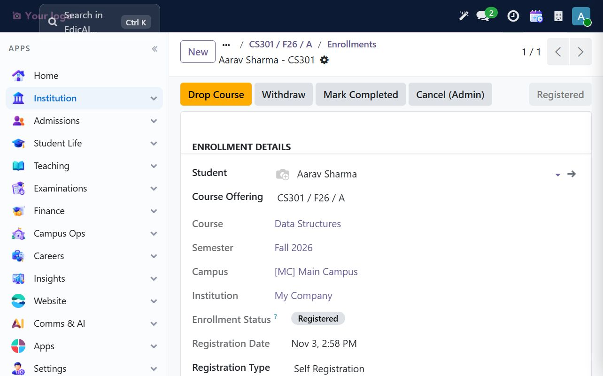

## 8.2 Check the grade scale

Open **Grading → Grade Scales** before entering marks. The clean UAT database has the active default **Standard 4.0 Grade Scale**, with eight bands from A+ through F. Confirm the percentage bands, grade points and passing flag match institutional policy before entering any grades.

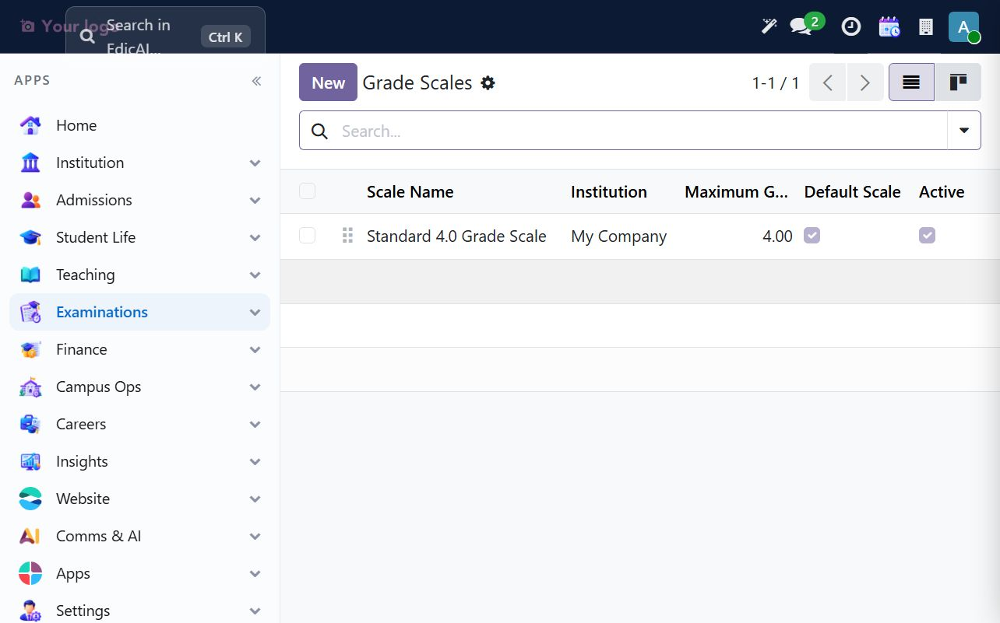

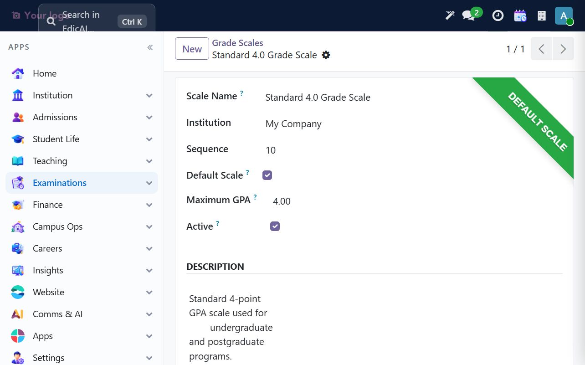

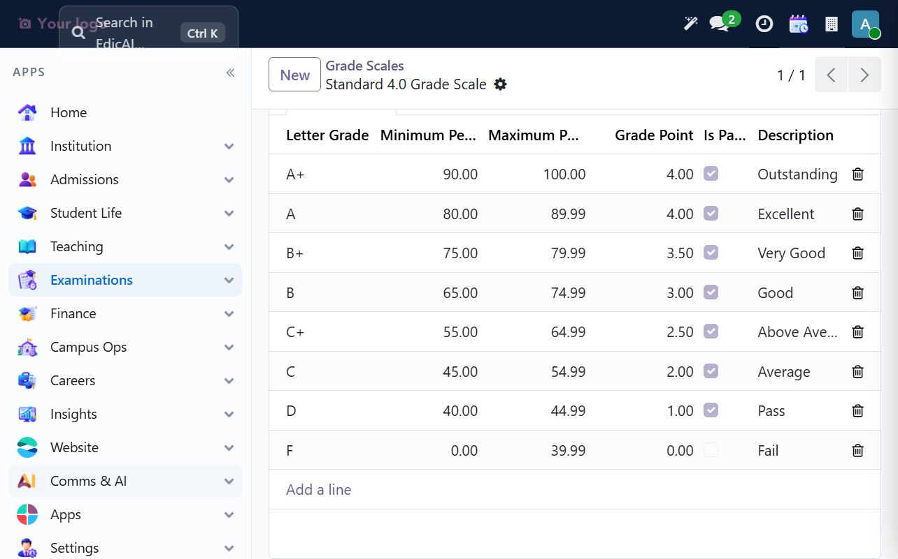

## 8.3 Attendance and fee eligibility come before hall tickets

Hall-ticket generation checks the attendance policy and fee ledger for each registered student. In the UAT policy, the minimum attendance is **75%**; other institutions may use a different policy. Unpaid fee invoices also make a student ineligible. A ticket can still be generated for an ineligible student, but its note explains the blocking condition; seating requires an **approved, eligible** ticket.

For the sample walkthrough we created a timetable entry for CS301, opened an attendance session, and marked Aarav **Present**. With the student's fee invoice fully paid, regenerating tickets refreshed the ticket to **Eligible**. In a live institution, use actual attendance records; do not override eligibility just to make a ticket pass.

> **Attendance-session caution:** in this UAT build, closing a session after marking records can fail during the attendance-statistics recompute. If that happens, leave the records intact and report the error rather than editing attendance directly. The exam ticket check reads the attendance records and applies the active policy.

## 8.4 Schedule and publish an exam

Open **Examinations → Examinations → Exam Schedules → New**. Choose the course offering, then set the exam particulars and venue.

| Field | Sample |
|---|---|
| Exam Name | `Midterm Exam - Data Structures` |
| Course Offering | `CS301 / F26 / A` |
| Exam Type | `Midterm Exam` |
| Exam Date | `11/20/2026` |
| Start / End | `10:00`–`11:30` |
| Exam Maximum Marks | `60` |
| Venue | `Engineering Exam Hall` (exam capacity 80) |
| Chief Invigilator | `Meera Iyer` |

Save the draft, review the course and room, then click **Publish**. Publishing makes the schedule available for ticket generation.

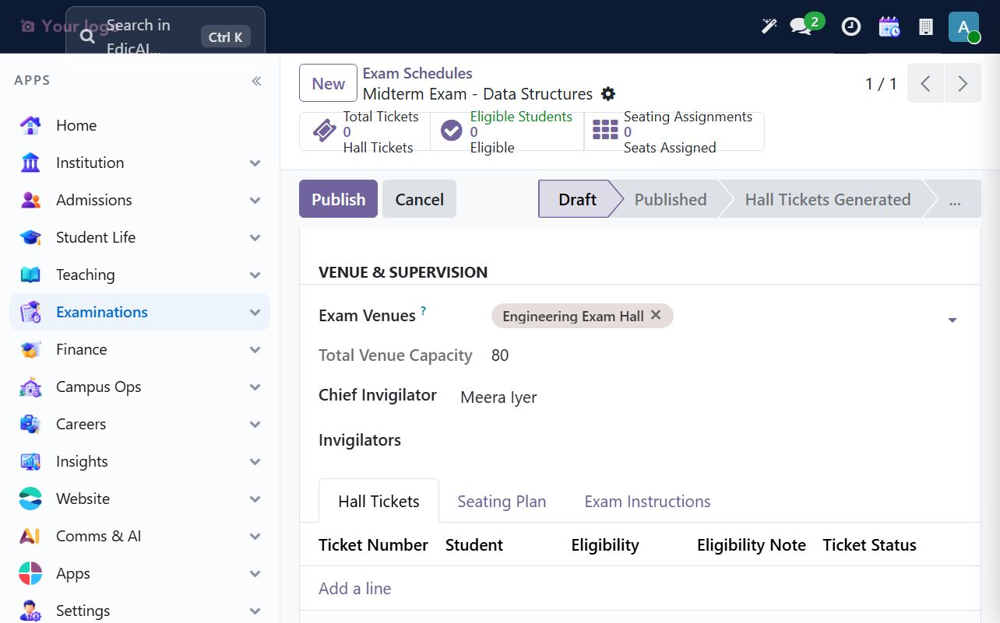

## 8.5 Generate and approve hall tickets

From the exam schedule, click **Generate Hall Tickets**. Edicai processes registered enrollments and records each student's eligibility result. If a ticket is ineligible, read **Eligibility Note**, resolve the attendance or fee issue, then run **Generate Hall Tickets** again to refresh it.

For the sample, ticket `HT/2026/00001` for Aarav is **Eligible**. Open the ticket and click **Approve**. Do not approve a ticket that is ineligible; the separate admin override is for authorized exceptions only, not a normal workaround. The override records the approving administrator in the eligibility note; follow institutional policy for separately documenting the exception reason.

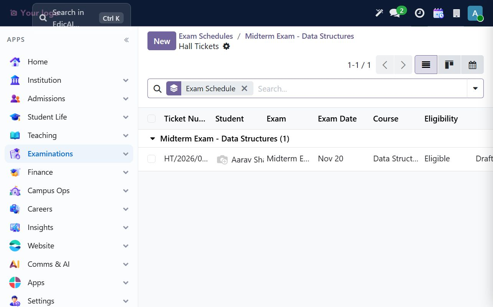

## 8.6 Generate the seating plan

Once eligible tickets are approved and the exam has a venue, return to its schedule and click **Generate Seating Plan**. Edicai assigns approved eligible students to seats in the selected room, up to its exam capacity. The sample schedule now shows one ticket, one eligible student and one seating assignment.

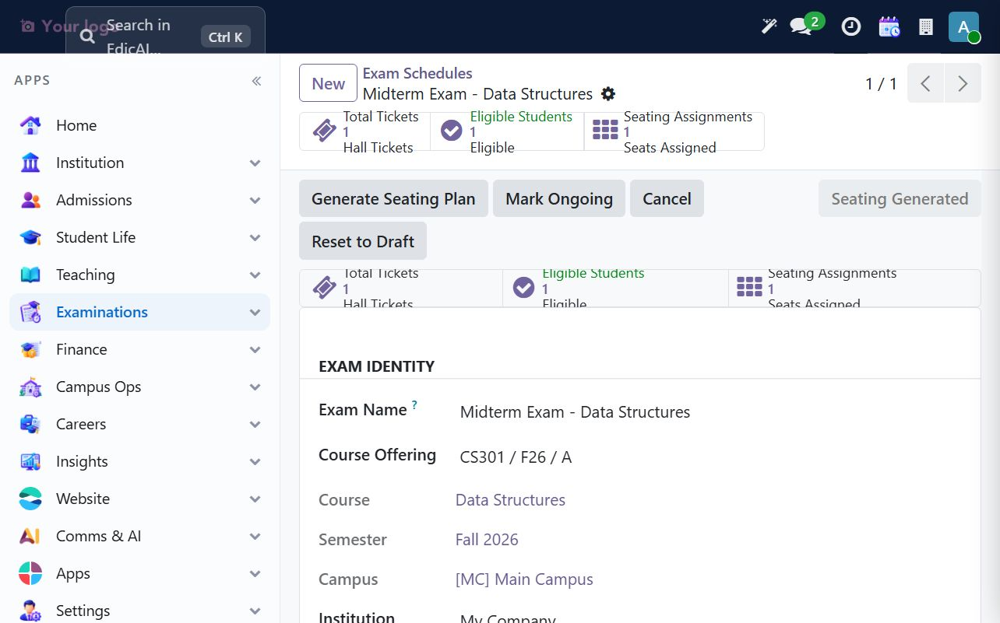

Open the **Seating Assignments** smart button to review the room roster. The sample seat label is `EEH-01-1` (Engineering Exam Hall, seat 1).

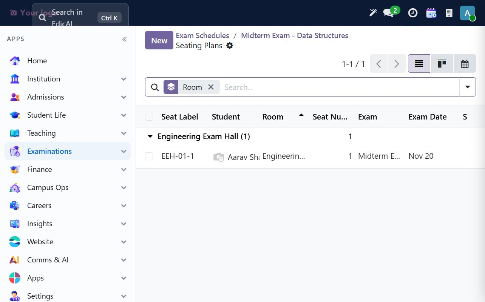

The schedule can then move to **Mark Ongoing** when the exam begins and **Complete** when it ends. These states track the event; they do not enter marks automatically.

## 8.7 Enter marks and follow the maker-checker workflow

Open **Grading → Grade Entry → New** and select the registered enrollment. Enter internal and external marks within the course's configured maxima. The sample course has a 40-mark internal component and a 60-mark external component.

The UAT example is **30/40 internal + 45/60 external = 75/100**. The default scale computes **75.00%**, **B+**, **3.50 grade points**, and **Pass**.

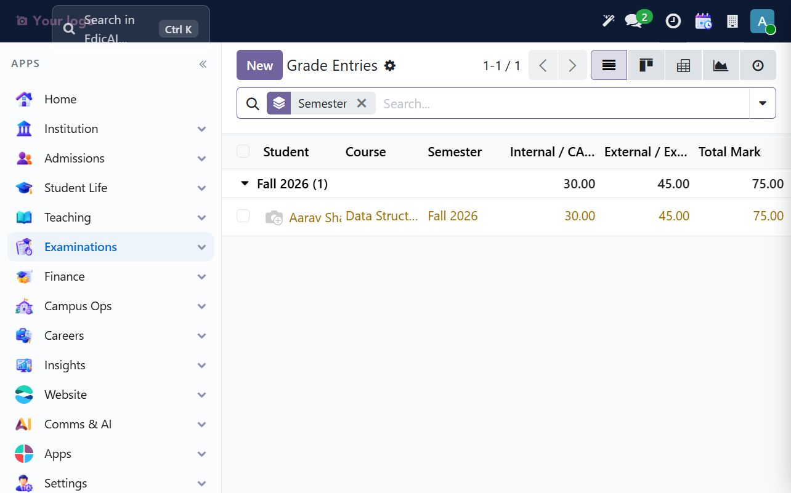

Use the workflow buttons in order:

1. **Submit** — faculty submits the marks.
2. **Verify** — a registrar, manager or administrator verifies them. The maker-checker rule prevents a non-admin faculty member from verifying their own entry.
3. **Publish Result** — publishes the grade and updates the enrollment to `Completed`, with its pass/fail status and final letter grade.

The sample grade entry was submitted, verified and published. Published grades feed semester-result calculation and credit totals; correct errors before publication because published entries cannot be reset to Draft.

## 8.8 Generate and publish the semester result

After grade entries for the semester are published, use the semester-result generation operation, then open **Grading → Semester Results** to review the GPA, credits, passed/failed course counts and result status. For the sample, Aarav's result is **Pass**, GPA **3.50**, 4.0 credits attempted and earned, and one course passed. Open the result and click **Publish Result** when it is approved for release to students.

> **Current-build limitation:** the Semester Results list and result publishing form are available in the UI, but the semester-result generation operation is not exposed as a normal UI button in this build. If no result record appears after grades are published, ask the Edicai administrator/development team to run the supported generation operation; do not create or edit a semester result by writing directly to the database.

## 8.9 Exam-day checklist

1. Confirm the offering is open and the student enrollment is `Registered`.
2. Confirm the grade scale is active and correct.
3. Check attendance and outstanding fee dues before ticket generation.
4. Publish the schedule, generate tickets, review eligibility notes, and approve only eligible tickets.
5. Generate seating and verify room capacity and seat labels.
6. Enter marks within the configured maxima; submit, independently verify and publish.
7. Generate/review semester results and publish them only after approval.

---

> ✅ **Checklist progress:** the UAT walkthrough completed the offering → enrollment → eligibility → schedule → hall ticket → seating → marks → verification → published result chain. Known UI and attendance limitations are recorded in the README so they can be addressed before relying on those paths in production.
> Campus Operations documentation is planned; that chapter is not yet available.
