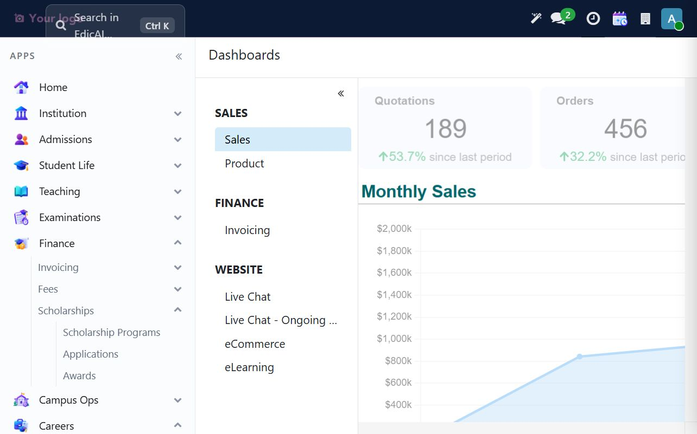
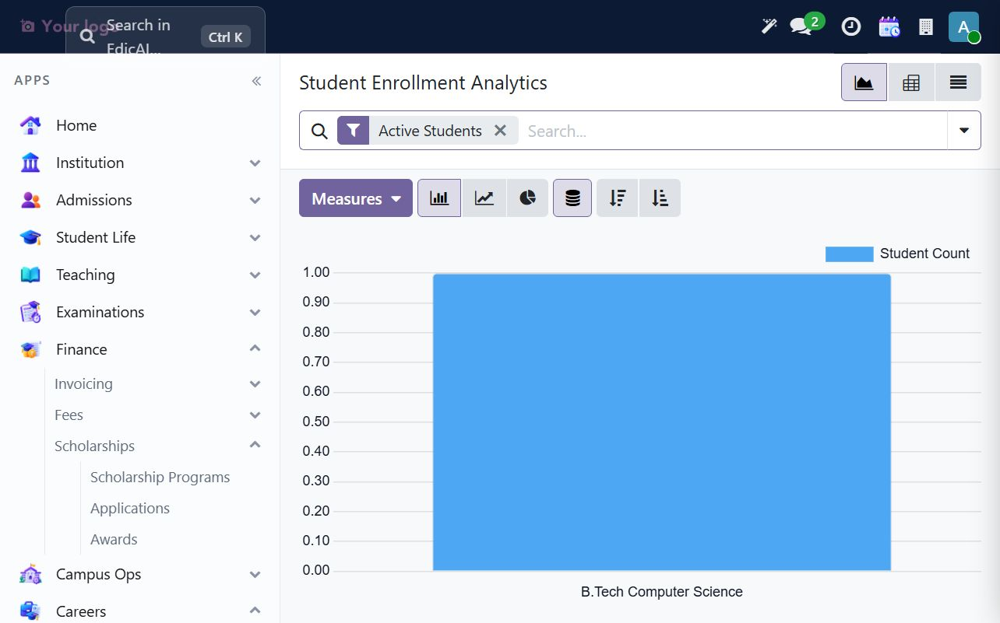
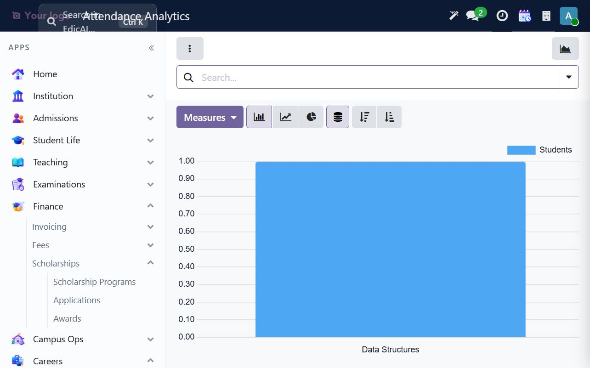
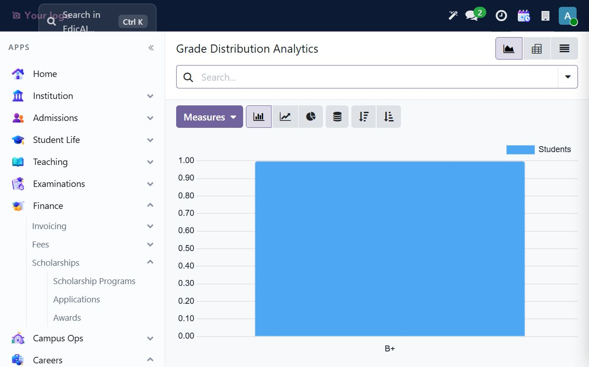
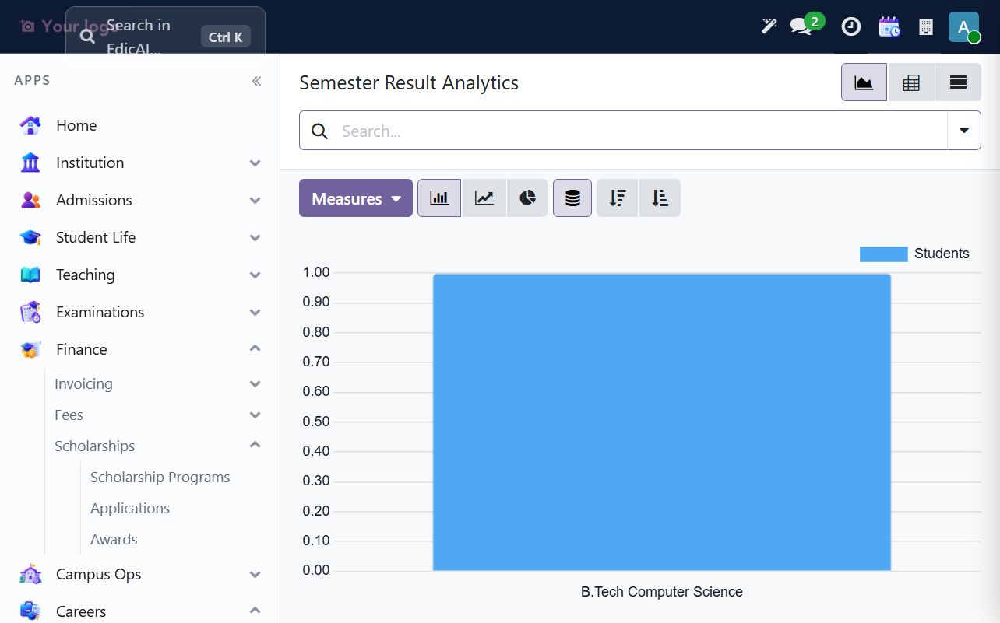
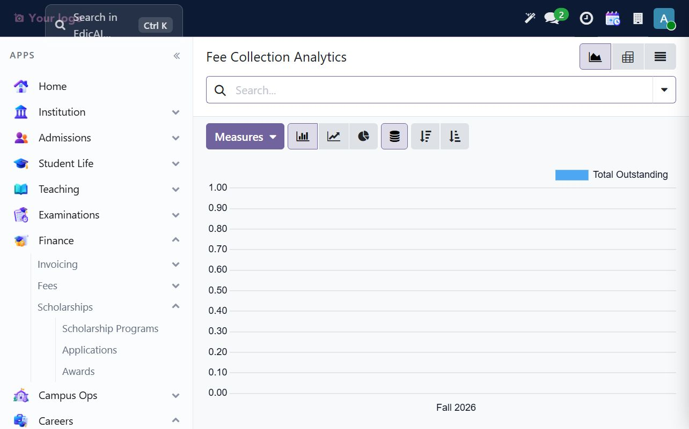

# 11. Insights — Dashboards & Reports

Use **Insights → Analytics** for Edicai's operational reports. The menu is grouped into **Student Analytics** (Enrollment Trends, Attendance Analytics), **Academic Analytics** (Grade Distribution, Semester Results), **Financial Analytics** (Fee Collection, Payment Methods) and **Admission Analytics** (Admission Funnel, Category Distribution). **Finance Reports** provides related finance dashboard and analysis views.

## 11.1 Dashboard gallery versus Edicai analytics

**Insights → Dashboards** opens Odoo's general dashboard gallery, with sections such as Sales, Product, Invoicing, Website, Live Chat, eCommerce and eLearning. Those are standard Odoo dashboards and may display seeded/demo-looking figures; they are not Edicai's student or academic KPIs. Use the **Analytics** reports below for institution-specific operational data.

## 11.2 Read the analytics controls

Analytics actions use the standard Odoo search bar and view controls. Common controls include the active filter chips, **Measures**, graph type (bar, line or pie), pivot/table view, sorting and group-by options. Change the measure and grouping deliberately; a chart can look very different when showing counts, totals or averages.

## 11.3 Student and attendance analytics

Open **Insights → Analytics → Student Analytics → Enrollment Trends** to group active students by program, campus, academic year or status. In the UAT sample, the Active Students report shows one student in B.Tech Computer Science.

Open **Attendance Analytics** to review attendance by course offering. The sample chart shows the Data Structures offering and its one recorded student. The result depends on the records and filters available for the selected period; inspect the report's filters before comparing courses.

## 11.4 Academic outcomes

**Academic Analytics → Grade Distribution** aggregates recorded letter grades; the UAT sample contains one B+ result. **Semester Results** groups the published semester-result population by program; the sample shows one B.Tech Computer Science student. Use the Semester Results list (Grading workspace) for an individual student's detailed GPA and credits.

## 11.5 Finance and admissions reports

**Financial Analytics → Fee Collection** summarizes outstanding balances by academic period. The sample Fall 2026 fee invoice was fully paid, so the outstanding measure is zero. **Payment Methods** groups receipts by payment method. Finance Reports also provides a Finance Dashboard, Fee Summary, Overdue Analysis and Scholarship Spend.

**Admission Analytics → Admission Funnel** and **Category Distribution** summarize applicant pipeline progress and applicant composition. A clean UAT database can have few or no admission records; empty charts are not evidence that admissions are misconfigured. Confirm the selected cycle, date range and filters first.

## 11.6 Reporting routine

1. Start with the question: enrollment, attendance, grade outcomes, collections or applicant conversion.
2. Open the matching report from **Insights → Analytics** rather than relying on generic gallery tiles.
3. Confirm active filter chips and the selected academic period before interpreting totals.
4. Choose the right measure, then group by program, campus, course or status as needed.
5. Compare the chart with the underlying operational list when a number is surprising.
6. Treat the one-student UAT charts as workflow checks, not production benchmarks or forecasts.

---

> ✅ **Checklist progress:** the walkthrough reviewed enrollment, attendance, grade, semester-result and fee-collection analytics, and distinguished Edicai operational reports from the general Odoo dashboard gallery. Next: [Comms & AI — Notifications & AI Tools](12_comms_ai.md).
