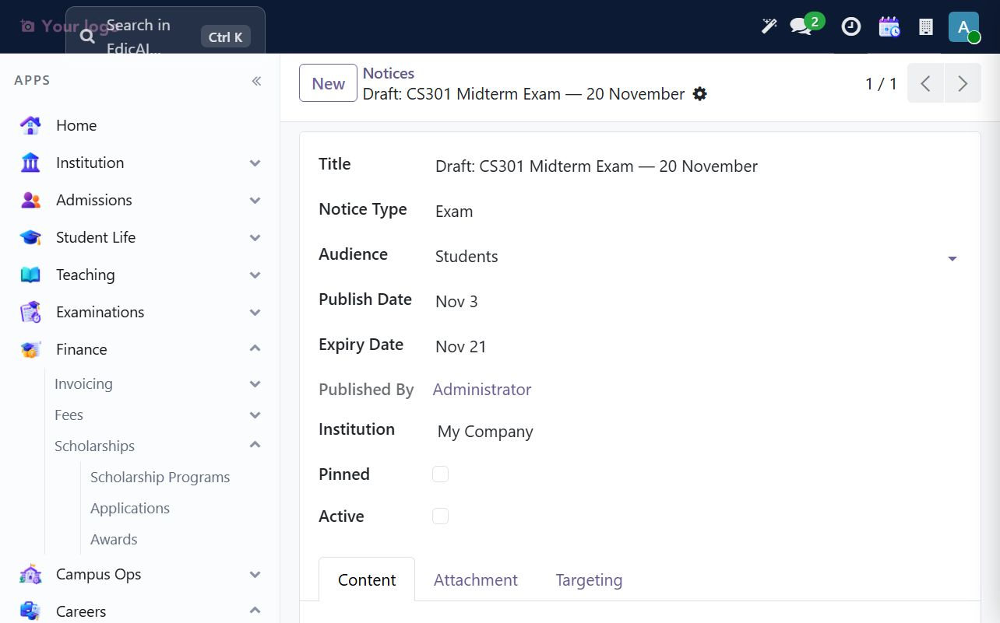
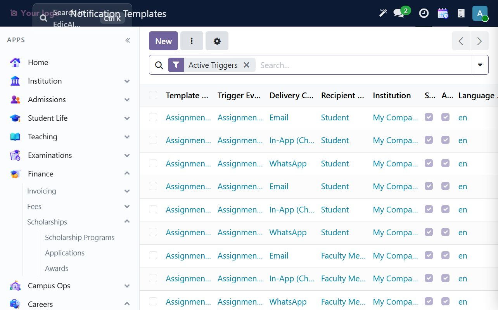
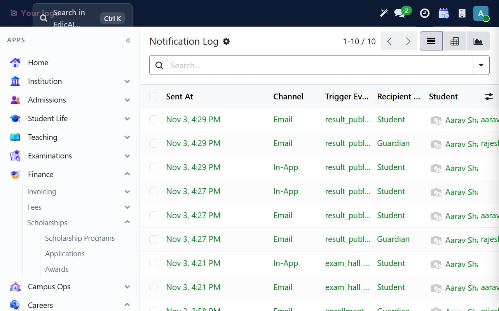
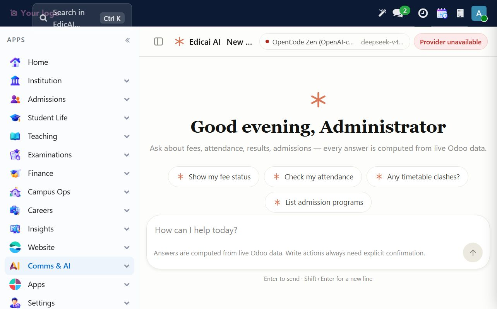

# 12. Comms & AI — Notifications, Notices and AI Tools

This chapter covers how Edicai communicates with students, guardians, faculty and staff, and how Edicai AI fits into the workflow. It contains announcements and operational messaging, not academic decisions. Do not use an announcement, notification or AI response as the only record of an academic outcome; keep the authoritative record in the relevant module.

## 12.1 Where communications live

Open **Comms & AI**. The principal entries are:

| Menu | Purpose |
|---|---|
| Discuss | Internal chat and activity conversations |
| Edicai AI | Guided answers and drafting assistance from live Odoo data |
| Appointments | Faculty appointment slots and booking management |
| Notice Board | Institution-wide or targeted notices |
| Documents | Institutional and student documents |
| Notifications | Operational notification log and templates |
| Email Marketing | Mailing lists, messages and campaigns |
| Live Chat | Website live chat operation |

Scholarship and admission communications may create notification-log rows as part of their own workflows. Use the relevant workflow's own status as the source of truth, then verify the notification log.

## 12.2 Notice Board: publish deliberately

Open **Comms & AI → Notice Board → Notices**. The UAT board contains seeded example records; inspect the notice type, audience, dates and scope before relying on them. Use **New** for an official communication.

Recommended workflow:

1. Set the **Title**, **Notice Type** (General, Academic, Exam, Fee or Event), **Audience** and **Institution**.
2. Set an **Expiry Date** for time-bound communications.
3. Draft the **Content**; keep required actions and dates explicit.
4. Restrict the audience where possible rather than broadcasting to everyone.
5. Create the notice inactive and unpinned, then verify title, audience, target and dates with another administrator before enabling it.
6. Only make it active after approval.

The UAT verification created **Draft: CS301 Midterm Exam — 20 November** as an Exam notice for Students, expiring 21 November. It is deliberately **inactive and unpinned**, with no external communication issued. Use this pattern for high-impact exam, fee and deadline notices.

## 12.3 Notifications: templates and logs

Open **Comms & AI → Notifications**.

- **All Notifications** — operational delivery record.
- **Today's / Failed Notifications** — daily monitoring and failed delivery review.
- **Notification Templates** — trigger, channel, audience, language and institution scope.
- **Notification Settings** — available channels and configuration.

The UAT template register includes email, in-app and WhatsApp templates for assignments, attendance shortage alerts and results. The templates are pre-seeded and should be reviewed for wording, language and recipient scope before enabling a new trigger.

The notification log shows the events generated during this walkthrough, including results, hall tickets and enrollments. In the screenshot these rows were created in UAT; they are evidence that the workflow emitted an event, **not proof that an external message was received**. Confirm the configured mail, SMS or WhatsApp channel and inspect failed delivery before assuming a student or guardian received an external message.

> **Verification rule:** a log row with status `Sent` means Edicai recorded or attempted a send according to its channel configuration. It does not prove inbox receipt, phone delivery, or guardian acknowledgement. Use channel-specific delivery evidence and follow up on failed rows.

## 12.4 Edicai AI: safe-use rules

Open **Comms & AI → Edicai AI → Workspace**. Edicai AI can summarize or draft content against Odoo data and propose actions, but it does not replace the responsible administrator's judgement.

Use it for:

- Drafting a first-pass announcement, quiz or exam notice for review.
- Summarizing a record you have already opened with the crosshair action.
- Asking for missing data checks before a workflow.

Do not use it to:

- Publish, send or change records without explicit approval and confirmation.
- Make academic eligibility, scholarship, disciplinary, fee or admissions decisions.
- Quote a number without checking the originating form or report.
- Paste credentials, private student information, or confidential documents into an AI prompt.

In the current UAT workspace, the provider status is visibly **Provider unavailable** (`OpenCode Zen / deepseek-v4...`), so live AI responses were not available for verification. That is a valid state: the UI remains usable for discovery, but answer quality and external calls must not be assumed. If a real administrator workflow depends on AI, configure and test the approved provider first; then test harmless questions and inspect the audit log before using student data.

## 12.5 Practical review checklist

1. Classify the message: internal chat, internal notification, notice board, email marketing or AI-assisted draft.
2. Confirm the audience and exact scope; avoid `All` unless every recipient is intended.
3. Check content for errors: date, time, fee amount, room, policy, link and contact.
4. For an inactive draft, review with a second person before activating or sending.
5. Check the notification log after the workflow and investigate failed or unexpected recipients.
6. For AI-assisted text, correct the draft manually, verify every fact, and then use the relevant module's publish/send action only after approval.

---

> ✅ **Checklist progress:** the walkthrough created an inactive exam notice and inspected notification templates and logs. Edicai AI is visible but unavailable in UAT; no provider change, external message, or unapproved communication was made. Next: [Website & Apps — Overview](13_website_apps.md).
