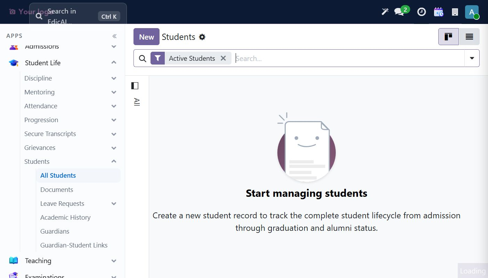
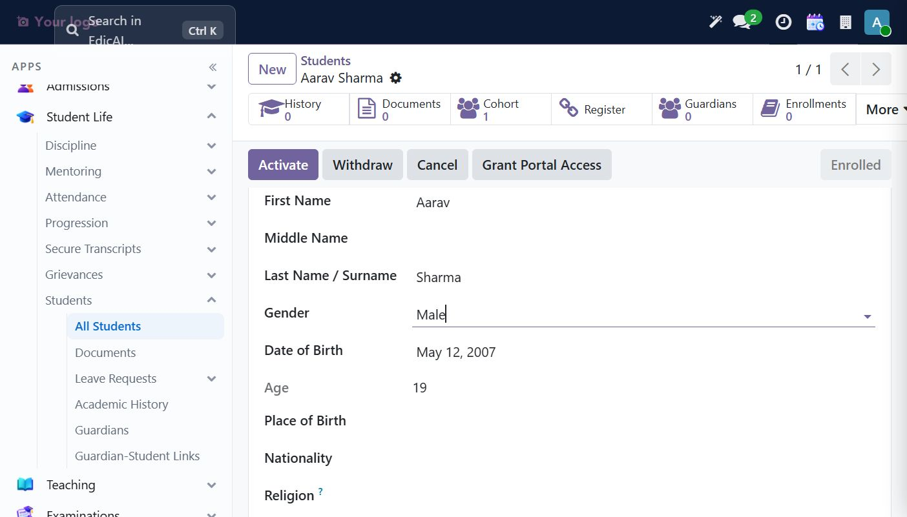
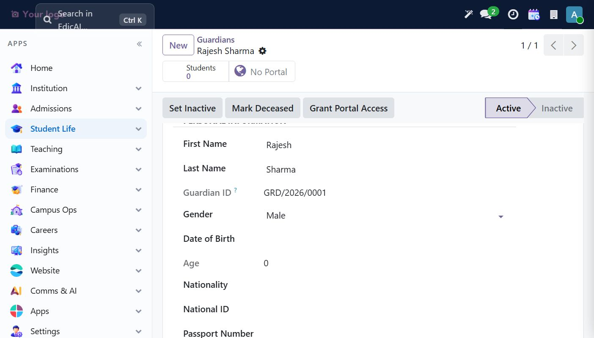
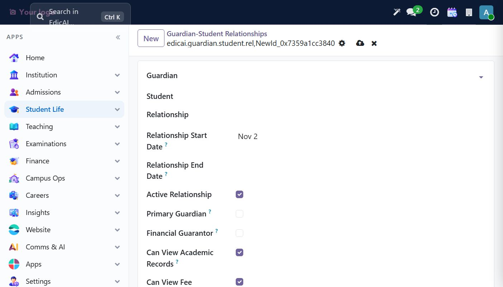
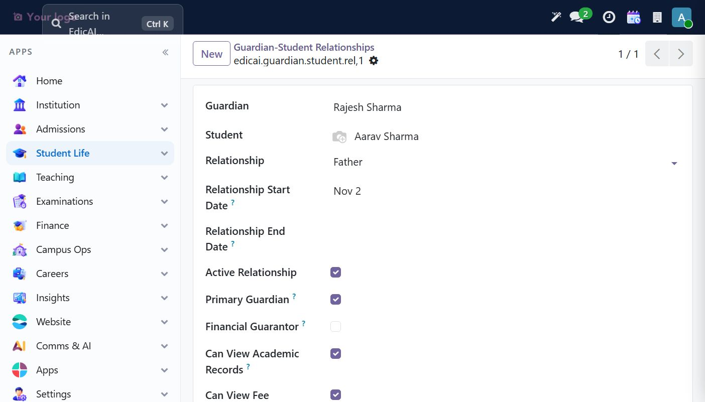
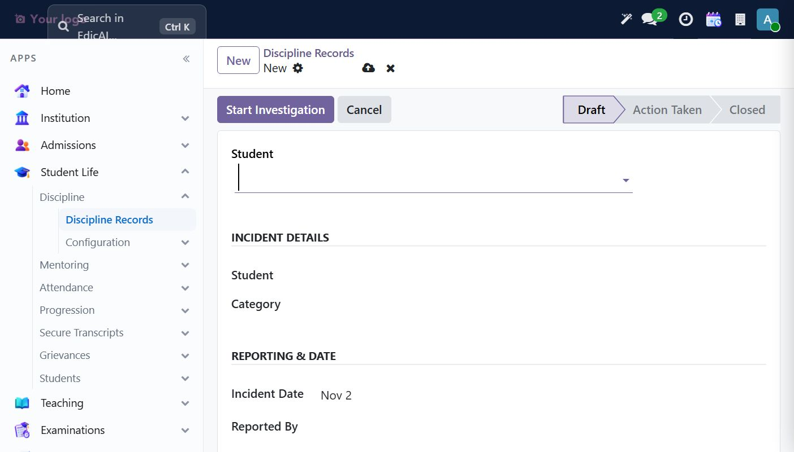
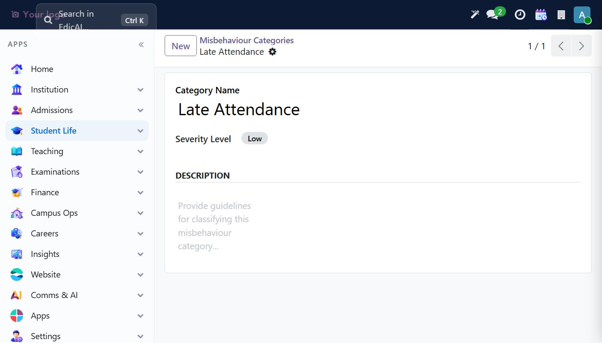
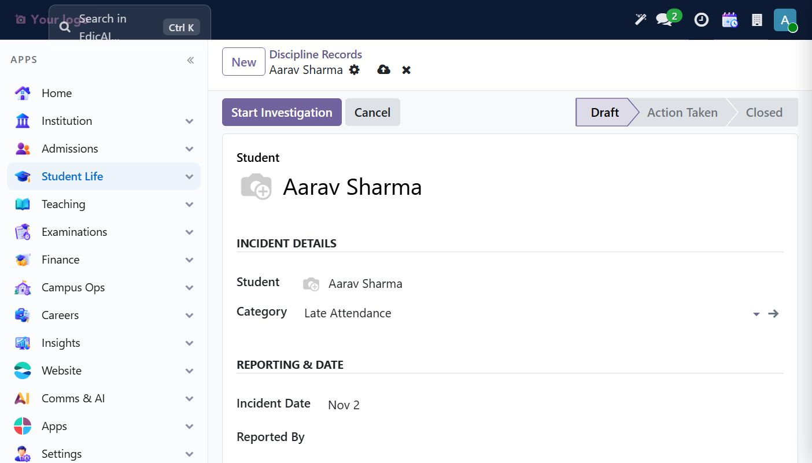
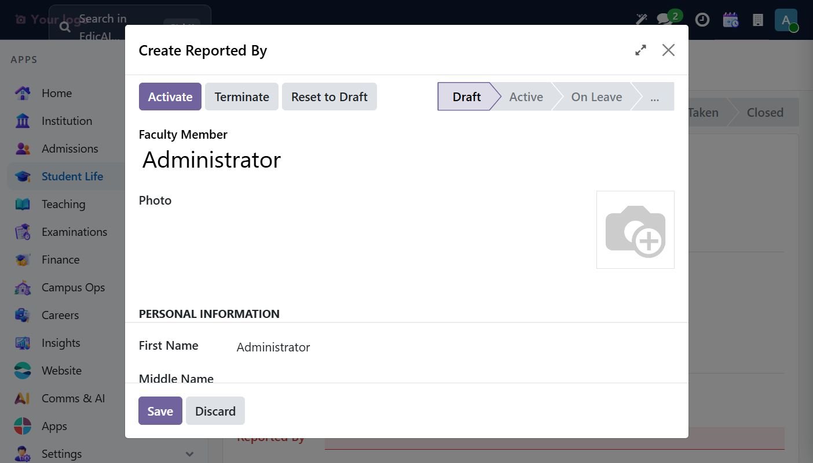

# 5. Student Life — Students, Guardians & Discipline

Navigation: **Student Life** workspace (`Students ▸ All Students / Documents / Leave Requests / Academic History / Guardians / Guardian-Student Links`, plus Discipline, Mentoring, Attendance, Progression, Secure Transcripts, Grievances).

## 5.1 Creating a student

**Student Life → Students → All Students** starts empty with the *"Start managing students"* empty state — the sidebar note explains the lifecycle covers **admission → graduation → alumni**:

Click **New**. The student form opens in **Admitted** state with workflow buttons **Enroll Student / Withdraw / Cancel**, a **Grant Portal Access** button, and smart buttons (History, Documents, Cohort, Guardians, Enrollments):

### Personal Profile tab

Fill identity details — the list includes **Gender** (Male/Female/Other/Prefer Not to Say), **Date of Birth** (typing `05/12/2007` → displays "May 12, 2007"), and **Age which computes automatically (19)**:

> 💡 Gender and other chips are **selection dropdowns** — typing alone doesn't commit the value; open the dropdown and pick. Required fields (Personal Email, Mobile) block save with a red underline.

### Academic Placement

| Field | Example | Notes |
|---|---|---|
| Program | `B.Tech Computer Science` | Requires an **Active** program (Module 4) |
| Batch Year | `2026` | Default: current year |
| Current Semester | — | Fills via enrollment; pick the running term later |
| Campus | `Main Campus` | Master record |

## 5.2 Enroll the student

Click **Enroll Student** (also fires an implicit save). Result: status badge becomes **Enrolled**, the **Cohort** smart-button counts 1 (the student joined their batch cohort), and the buttons become **Activate / Withdraw / Cancel / Grant Portal Access**:

> ✅ Checklist step 7 (attendance workflow) builds on this: attendance sessions are opened per offering/section — see the Attendance chapter later.

## 5.3 Guardians

**Student Life → Students → Guardians → New.** Identity + contact details; **Gender** required. On save, a **Guardian ID sequence issues `GRD/2026/0001`** automatically:

Workflow: `Active → Inactive` via **Set Inactive**, plus a sombre **Mark Deceased** action; **Grant Portal Access** provisions the guardian's portal login.

## 5.4 Guardian ↔ Student relationship

**Student Life → Students → Guardian-Student Links → New.** This record carries the family relationship *and* fine-grained permissions — **Primary Guardian / Financial Guarantor**, and per-scope toggles *Can View Academic Records*, *Can View Fee Records*, *Receive Notifications* (defaults ON):

Result (`Father`, `Primary Guardian`, Active):

> ⚠️ **Known display bug:** unsaved records of this model show the raw technical name (`edicai.guardian.student.rel,NewId…`) in the breadcrumb — the model lacks a display name. Cosmetic only; after save the fields themselves read fine. Flag for the dev backlog.

## 5.5 Discipline workflow (checklist step 12)

**Student Life → Discipline → Discipline Records → New.** State pipeline `Draft → Action Taken → Closed`, started by the **Start Investigation** button:

Categories live in **Discipline → Configuration → Misbehaviour Categories** (Name + Severity chips Low/Medium/High). Create at least one (e.g. `Late Attendance`, severity *Low*):

Then pick Student + Category on the record:

### The dependency you'll meet

**Start Investigation** requires *Reported By* — a **Faculty Member** (staff record). Odoo offers the inline **"Create Reported By"** modal right in the flow:

> ⚠️ The modal's **Department** field points to the *HR department* model, not the edicai academic department — so full staff onboarding is done properly in **Institution → Faculty & Staff → Faculty Members** (next: Teaching chapter). Create staff there first, then return to discipline records and pick the reporter.

> ✅ **Checklist progress:** Step 12 (discipline escalation) — setup captured; complete the Take Action → Closed loop in the staff chapter walkthrough.
