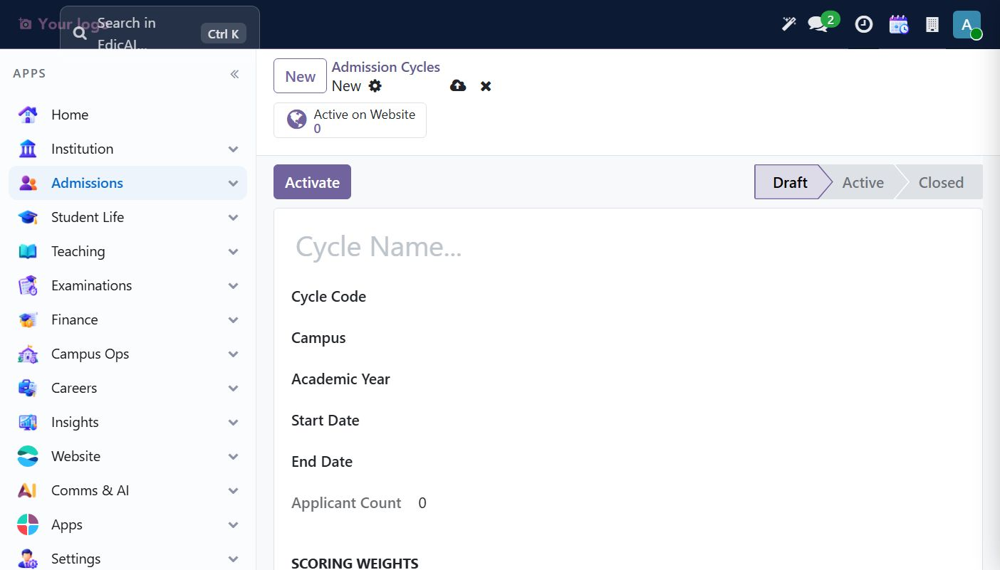
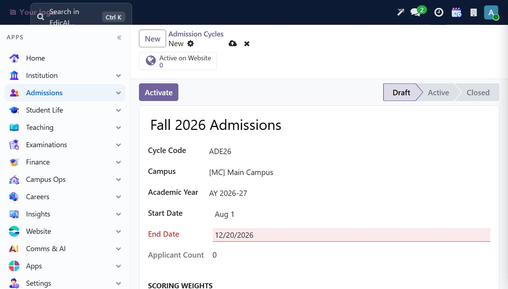
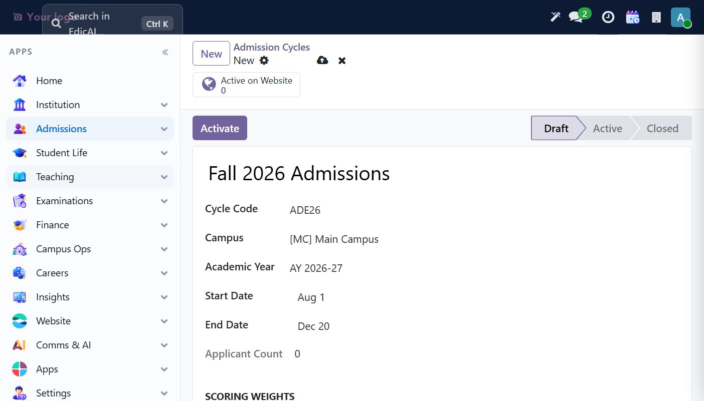
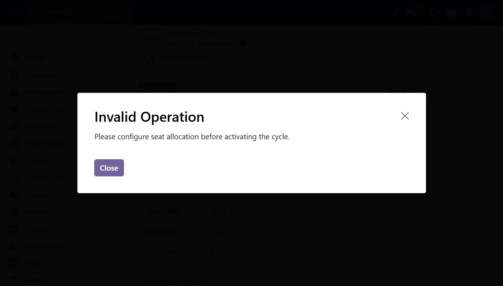
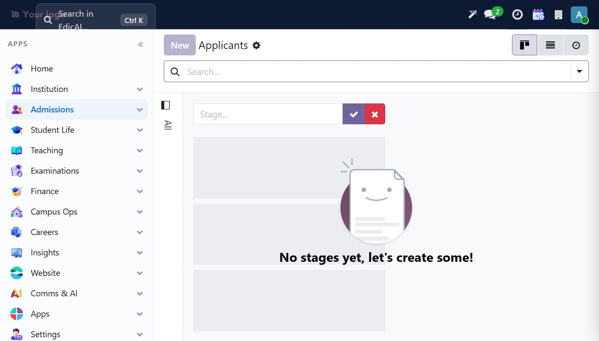
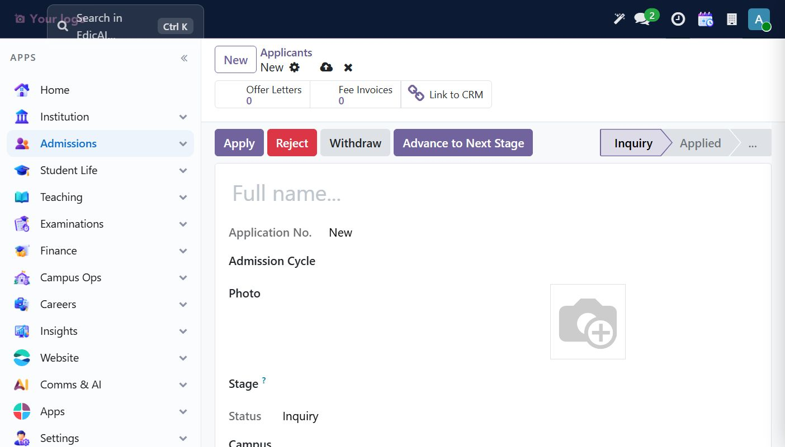
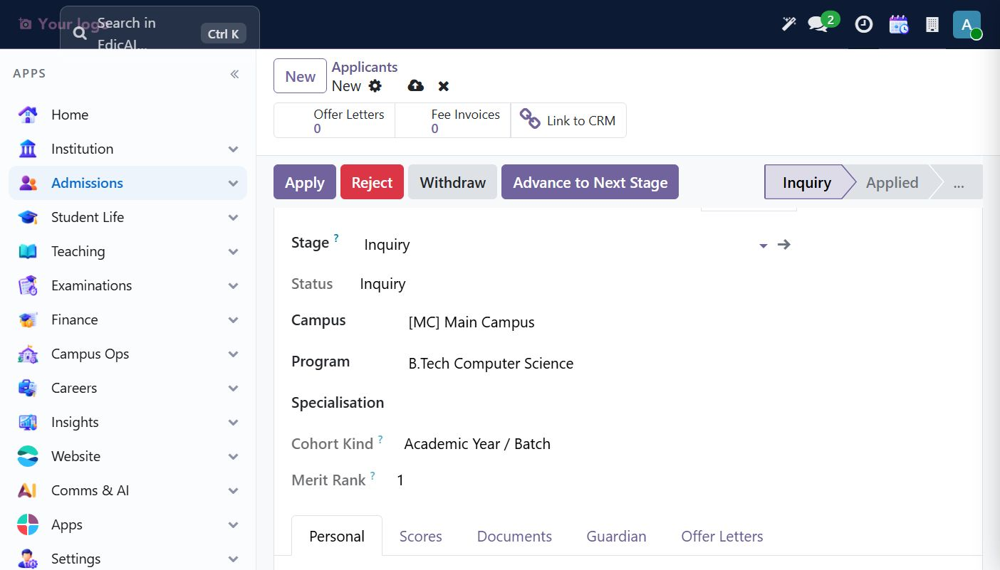

# 6. Admissions — Cycles, Seats & the Applicant Pipeline

Navigation: **Admissions → Admission** (`Admission Cycles`, `Applicants`, `Admission Enrollments`, `Stages`, `Entrance Tests`, `Offer Letters`, `Enrollments`, `Configuration`) plus a CRM section for lead management (checklist steps 13–15 live here).

## 6.1 The dependency rule for admissions

Before an applicant can move through the pipeline you must have, in this order:

1. An **Active program** offering at the campus (Module 4) — btech
2. An **Admission Cycle** linked to the active academic year — this one comes first because the Applicants kanban refuses to show stages without it ("No stages yet, let's create some!")
3. **Seat allocation** per program on the cycle — required by the `Activate` guard.

## 6.2 Create the Admission Cycle

**Admissions → Admission → Admission Cycles → New.**

| Field | Example |
|---|---|
| Cycle Name | `Fall 2026 Admissions` |
| Cycle Code | `ADE26` |
| Campus | `Main Campus` |
| Academic Year | `AY 2026-27` |
| Start Date | `08/01/2026` |
| End Date | `12/20/2026` |

 

> ⚠️ **Date picker pitfall:** typing a date doesn't commit it — you must pick the day in the calendar. A typed-but-unpicked date stays red/blocked until the picker click commits it (Start showed *"Aug 1"* only after the day was physically clicked):

 

### SCORING WEIGHTS & Seat allocation

Lower on the form: **SCORING WEIGHTS** (Aggregate / Entrance / Interview %) drive the composite score used for merit ranking. The **Seat Allocation** tab lists one row per offered program:

| Field | Example |
|---|---|
| Program | `B.Tech Computer Science` |
| Total Seats | `90` |

Click **Add a line**, pick the program, set seats, save.

### Activate — and the guard

**Activate** refuses without seats:

> **Invalid Operation** — *Please configure seat allocation before activating the cycle.*

After adding the seat line, `Activate` flips the cycle `Draft → Active`. The applicant banner **Active on Website** visible on the record tracks whether the cycle accepts web applications.

## 6.3 Stages & the pipeline

The stage model ships 13 records (Inquiry, Applied, Documents Pending, Under Review, Shortlisted, Entrance Scheduled, …). One lesson from the walkthrough: **stages on the Applicants kanban only display when the underlying prerequisites (program/cycle) match** — on a fresh setup the kanban shows the empty state *"No stages yet, let's create some!"* until records exist in an active phase:

## 6.4 Create an applicant

**Applicants → New** (switch to the list view if the kanban's empty-state hides the *New* button):

The form carries the editable pipeline (`Inquiry → Applied → …`) plus buttons **Apply / Reject / Withdraw / Advance to Next Stage**, and smart buttons **Offer Letters / Fee Invoices / Link to CRM**.

Fill identity (Full Name, Gender, Stage — defaults `Inquiry`, this example `Ishita Verma`, program `B.Tech CS`, campus `Main Campus`) and **Admission Cycle = Fall 2026 Admissions** (required — the pipeline refuses to advance without it):

Then click **Apply** (or **Advance to Next Stage**) to move the funnel. Checklist steps **14 (review workflow)** and **15 (inquiry follow-ups)** use the same record: move to *Under Review*, schedule follow-up activities from the chatter (Schedule activity), and drive it to `Confirmed` to spawn a student.

## 6.5 Known display bug

Breadcrumb on unsaved records shows `edicai.guardian.student.rel,NewId…` style technical names for some models (relationship model lacks `_rec_name` — see Module 5 §5.4). Same applies to applicant records until first save.

---

> ✅ **Checklist progress:** Step 13 (pipeline) — demonstrated through cycle + seats + applicant creation. Steps 14–15 continue on the same record.
> Next chapter: [Finance — fee structures, invoices & payments](07_finance.md).
