# 7. Finance — Fee Structures, Invoices & Payments

Navigation: **Finance → Fees** — `Fee Operations` (Outstanding Invoices, All Invoices, Overdue Fees, Batch GL Migration), `My Fees`, and `Configuration` (Fee Structures, Accounting Configuration).

Finance in Edicai is built as a ledger on top of Odoo Accounting: a **fee structure** defines what a term costs, a **fee invoice** bills a student for it, and the invoice is mirrored into a **GL invoice** (`account.move`) which is what actually gets paid and reconciled. If Accounting is not configured, the fee invoice can still be created — it just cannot be sent.

## 7.1 The two configuration records you need first

| Record | Menu | Why it matters |
|---|---|---|
| Fee Structure | Finance → Fees → Configuration → Fee Structures | Defines the line items and amounts per program/semester |
| Fee Accounting Configuration | Finance → Fees → Configuration → Accounting Configuration | Maps fees onto a sales journal + revenue account so the GL invoice can be created |

Both are per-institution. **Only one active accounting configuration per institution**, and without one `Send to Student` refuses with:

> **Invalid Operation** — *Cannot create GL invoice: No active fee accounting configuration found for My Company.*

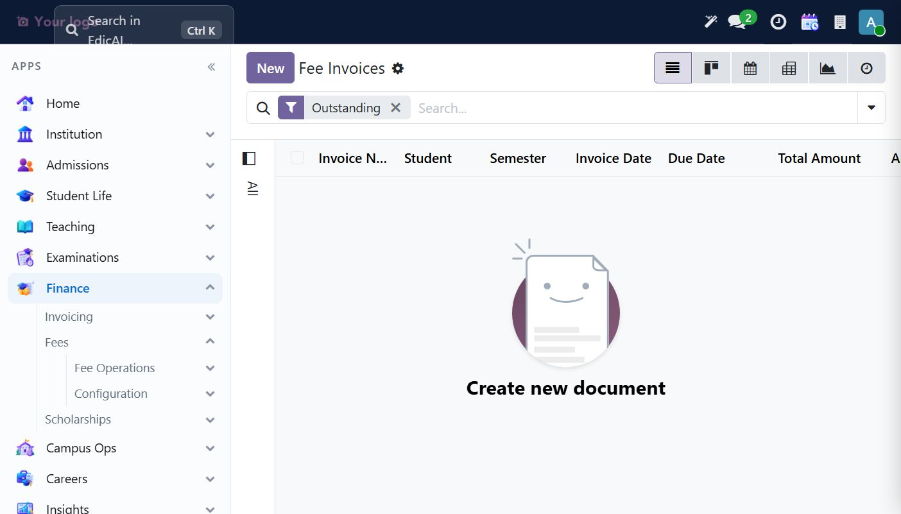

## 7.2 Create a Fee Structure

**Finance → Fees → Configuration → Fee Structures → New.**

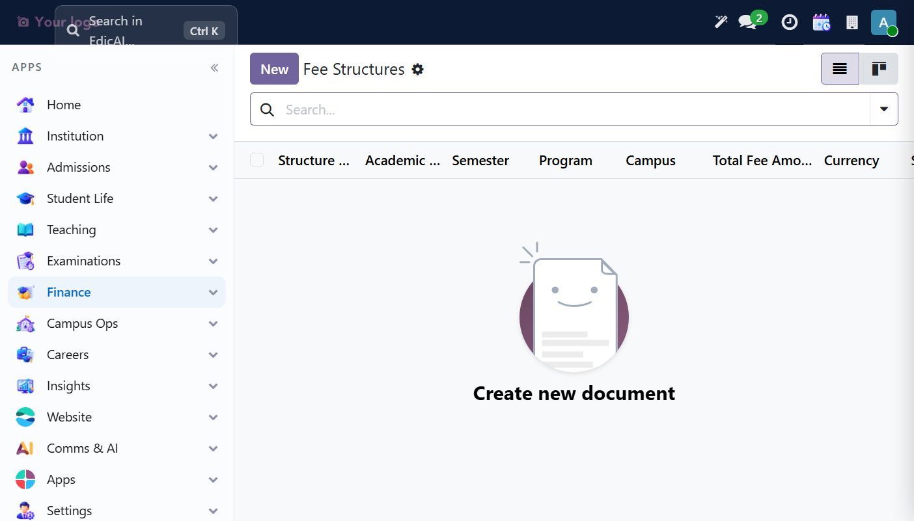

The header carries the scope of the fee: institution, academic year, semester, program, campus, currency, installment policy, due date and late-fee percentage.

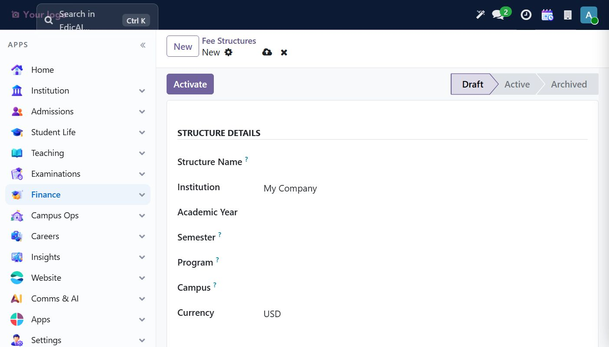

| Field | Example |
|---|---|
| Structure Name | `B.Tech Fall 2026 — Semester 1` |
| Institution | `My Company` |
| Academic Year | `AY 2026-27` |
| Semester | `Fall 2026` |
| Program | `B.Tech Computer Science` |
| Campus | `Main Campus` |
| Allow Installments? | ticked (Number of Installments defaults to `3`) |
| Fee Due Date | `12/20/2026` |

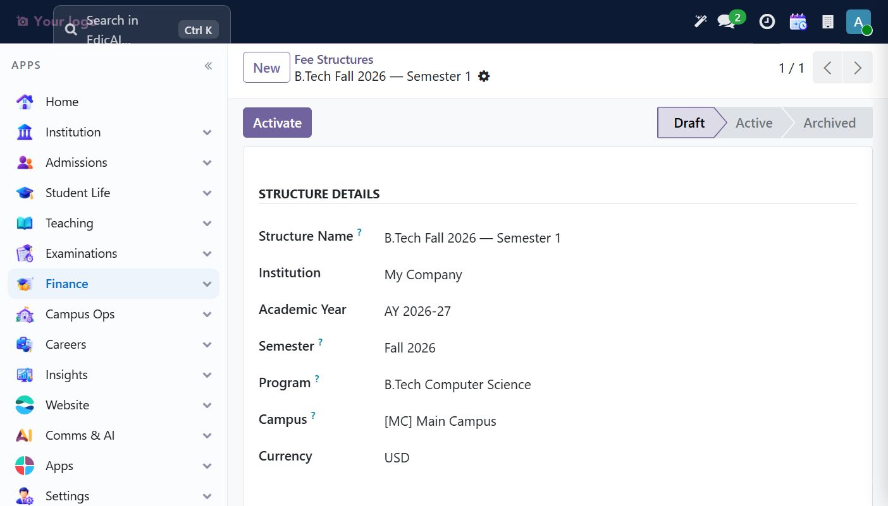

### Fee components (the lines table)

Click **Add a line**, then set Fee Type by clicking the cell and choosing from the dropdown — the eleven built-in types are Tuition, Library, Sports, Laboratory, Examination, Registration, Hostel, Transport, Development, Caution Deposit and Other. `Mandatory` and `Refundable` are per-line checkboxes.

| Fee Type | Description | Amount | Mandatory | Refundable |
|---|---|---|---|---|
| Tuition Fee | Tuition for Fall 2026 | `5000` | ✅ | ☐ |
| Hostel Fee | Hostel seat rent | `1200` | ☐ | ✅ |

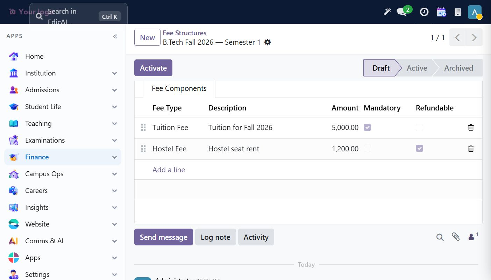

> ⚠️ **Working with the lines table:** the grid is easy to mis-fill because a new row inherits the previous row's values (including the Fee Type). After **Add a line**, click *into the new row's Fee Type cell* and pick the type explicitly, then check the amount and both checkboxes before saving. `Total Fee Amount` recalculates only on save — reload the record if it looks stale.

Finally click **Activate** (the structure moves `Draft → Active`). Only active structures can be used for new invoices.

## 7.3 Create the Fee Accounting Configuration

**Finance → Fees → Configuration → Accounting Configuration → New.**

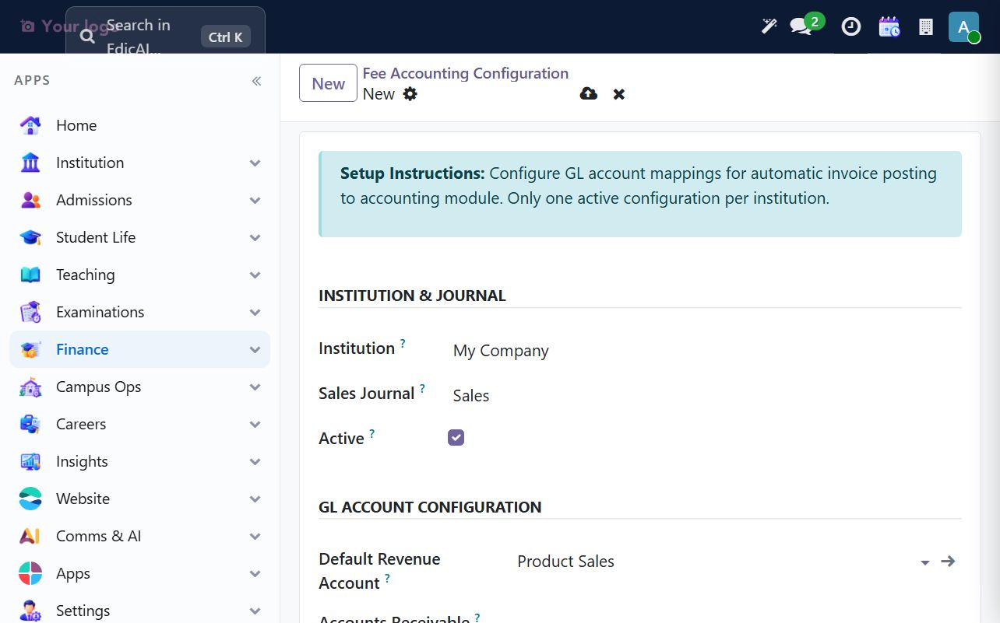

| Field | Example | Notes |
|---|---|---|
| Institution | `My Company` | Must match the invoice's company |
| Sales Journal | `Sales` | The journal the GL invoice is created in |
| Default Revenue Account | `Product Sales` (400000) | Income account for fee revenue |
| Accounts Receivable | optional | Leave blank to use the journal/company default |
| Auto-Post to GL | ☐ (off by default) | When off, GL invoices stay in **Draft** until you post them |
| Auto-Create Student Partner | ✅ | Creates an Accounting contact for each student |
| Active | ✅ | Only one active config per institution |

> 💡 **Field ordering gotcha:** the *Sales Journal* dropdown is filtered by the Institution you selected. If it only offers `Create "Sales"` and never the existing journal, it is because the institution field hasn't been committed — pick `My Company` from the dropdown first, then re-open the journal and type again.

Leave **Auto-Post to GL** off for the first weeks of go-live: every GL invoice then arrives in Draft and a finance officer must review the amounts before posting. Turn it on once the fee structures are trusted.

## 7.4 Build a fee invoice for a student

**Finance → Fees → Fee Operations → All Invoices → New.**

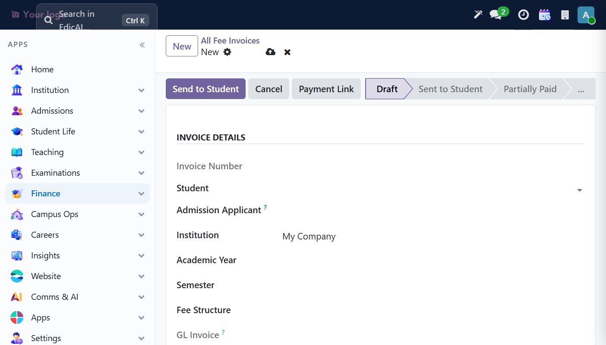

Fill Student, then pick the Fee Structure — choosing it copies the structure's lines into **Fee Breakdown**, sets the currency and, when the structure has a due date, the invoice due date:

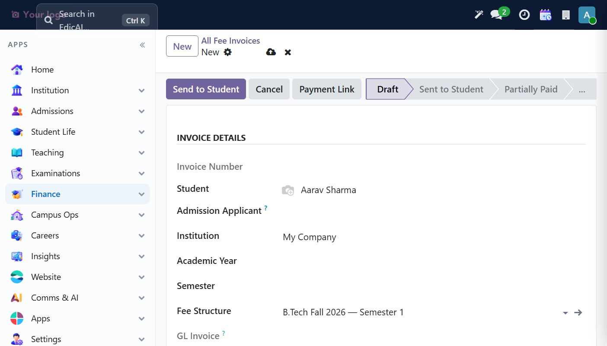

| Field | Example |
|---|---|
| Student | `Aarav Sharma` |
| Academic Year | `AY 2026-27` |
| Semester | `Fall 2026` |
| Fee Structure | `B.Tech Fall 2026 — Semester 1` |
| Invoice Date | `11/03/2026` |
| Due Date | `12/20/2026` |

Save. The invoice is numbered (`INV/2026/00001`) and totals **$6,200** (tuition 5,000 + hostel 1,200):

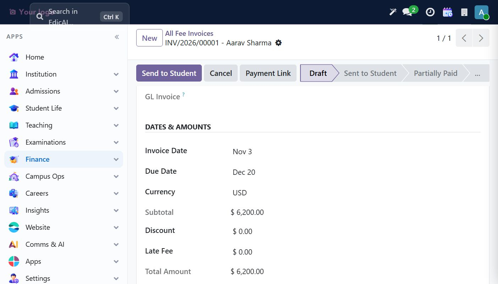

> ⚠️ **Academic Year must be committed**, not merely typed. If it is left as free text the save is blocked with the field highlighted in red. Pick the year from the dropdown like any other many2one.

### Invoice states

```
Draft ──Send to Student──▶ Sent to Student ──(payment)──▶ Partially Paid ──▶ Fully Paid
  │                              │
  └──────────Cancel──────────────┴──────────▶ Cancelled ──Reset to Draft──▶ Draft
```

* **Send to Student** — validates that lines exist, sets the state to `Sent to Student` and posts a message to the chatter. It is also the step that creates the GL invoice.
* **Cancel** — blocked once the invoice is `Fully Paid`.
* **Reset to Draft** — only allowed from `Cancelled`, and never once a GL invoice exists.

Clicking **Send to Student** moves the record to `Sent to Student` and adds a **GL Invoice** smart button showing `Draft`:

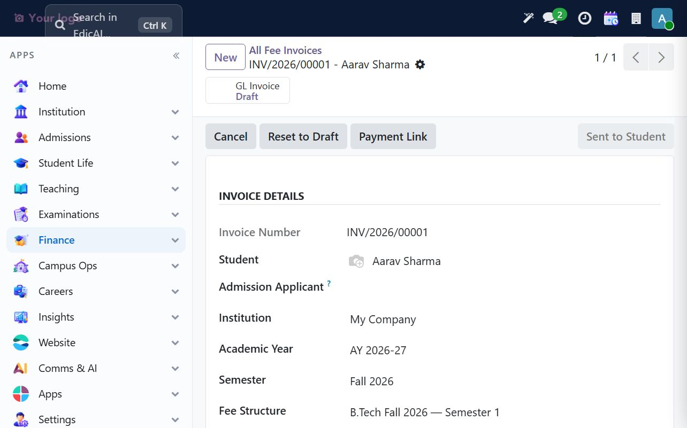

## 7.5 Post the GL invoice

Open the **GL Invoice** smart button. This is a standard customer invoice for the same student and amount, dated with the same terms:

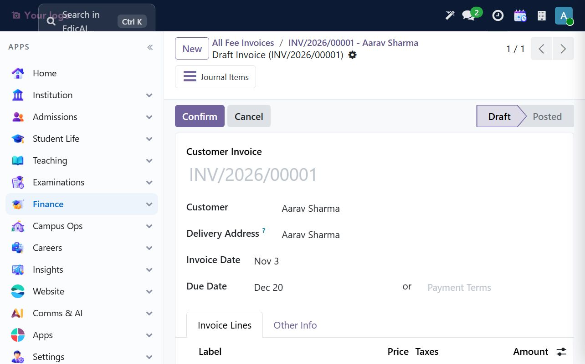

Click **Confirm** to post it. Return to the fee invoice — the smart button now reads `GL Invoice Posted` and a green **Record Payment** button appears:

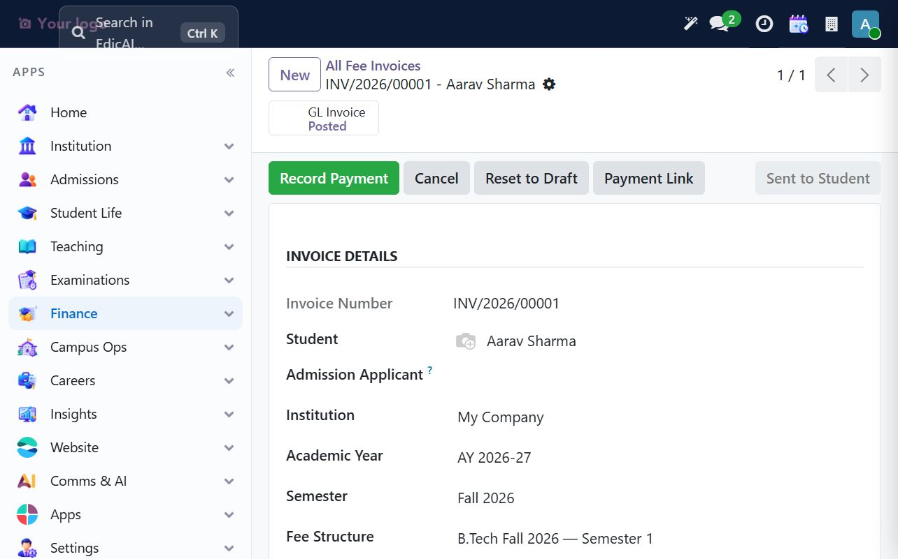

> ⚠️ **Money fields lock at posting.** Once the GL invoice is posted, the fee invoice's amounts, lines, student and semester become read-only. To correct an amount you must reverse the journal entry in Accounting first. This is deliberate — it keeps the fee ledger and the GL in sync.

## 7.6 Record a payment

**Record Payment** opens Odoo's standard payment wizard, pre-filled with the outstanding amount:

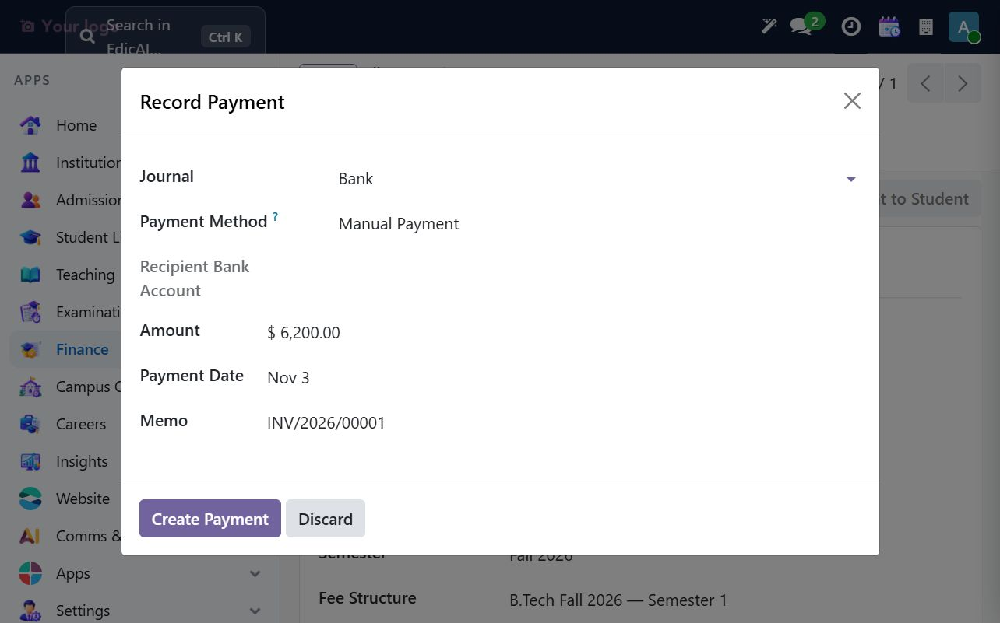

| Field | Default |
|---|---|
| Journal | `Bank` |
| Payment Method | `Manual Payment` |
| Amount | full outstanding (`6,200.00`) |
| Payment Date | today |
| Memo | the invoice number |

Lower the **Amount** to record a part payment (here `3,000.00`), then **Create Payment**. Odoo creates and posts a payment receipt:

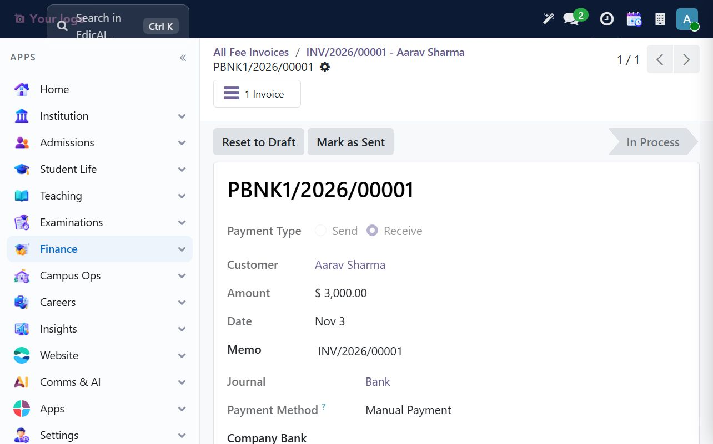

The fee invoice is refreshed by the GL reconciliation and drops to **Partially Paid** with the outstanding balance reduced automatically:

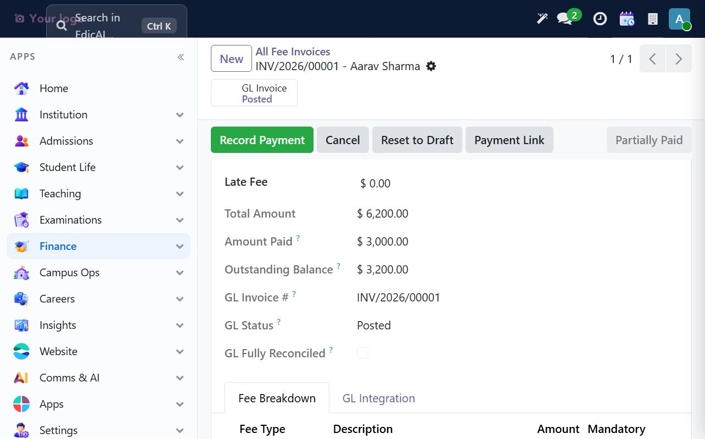

Recording the remaining `3,200.00` the same way moves it to **Fully Paid**, zeros the outstanding balance and ticks **GL Fully Reconciled**:

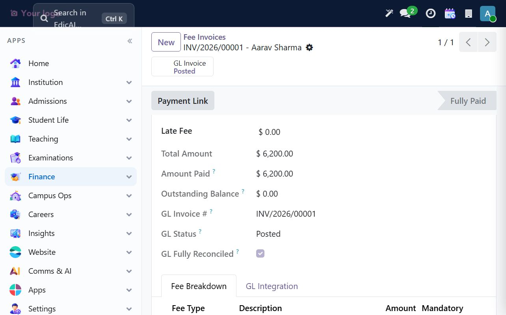

## 7.7 Monitoring collections

**Finance → Fees → Fee Operations → Outstanding Invoices** (action `Fee Invoices`) opens the invoice list pre-filtered to everything not yet settled, with an **Outstanding** search filter chip and the side panel grouping by Academic Year and Status:

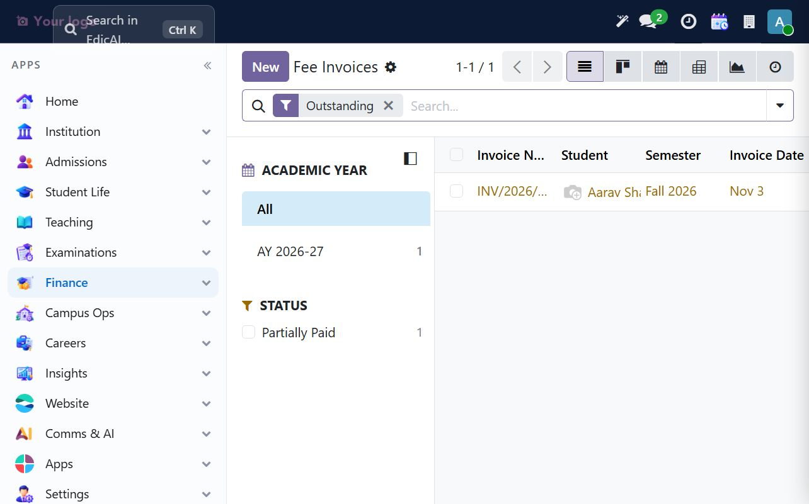

From here a finance officer can see at a glance: invoice number, student, semester, invoice date, due date, total, paid and outstanding. **Overdue Fees** is the same list restricted to past-due records, and **Fee Collection Analysis / Payment Analytics** under *Finance → Reporting* provide the pivot and graph views for month-end reporting.

### Daily finance routine

1. **All Invoices** → check nothing is stuck in `Draft` from yesterday.
2. **Outstanding Invoices** → follow up on `Partially Paid` and `Overdue`.
3. Reconcile the day's bank statement in Accounting; Edicai's fee states follow the GL automatically.
4. Before closing the month, confirm **GL Fully Reconciled** is ticked on every paid invoice.

---

> ✅ **Checklist progress:** Finance covers fee definition, student billing, GL posting and payment reconciliation end to end.
> Next chapter: [Examinations — Schedules, Grading & Results](08_examinations.md).
