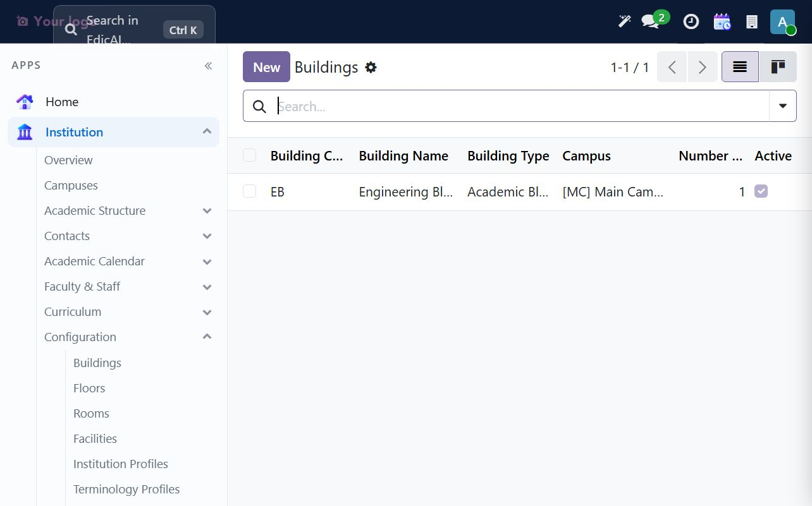
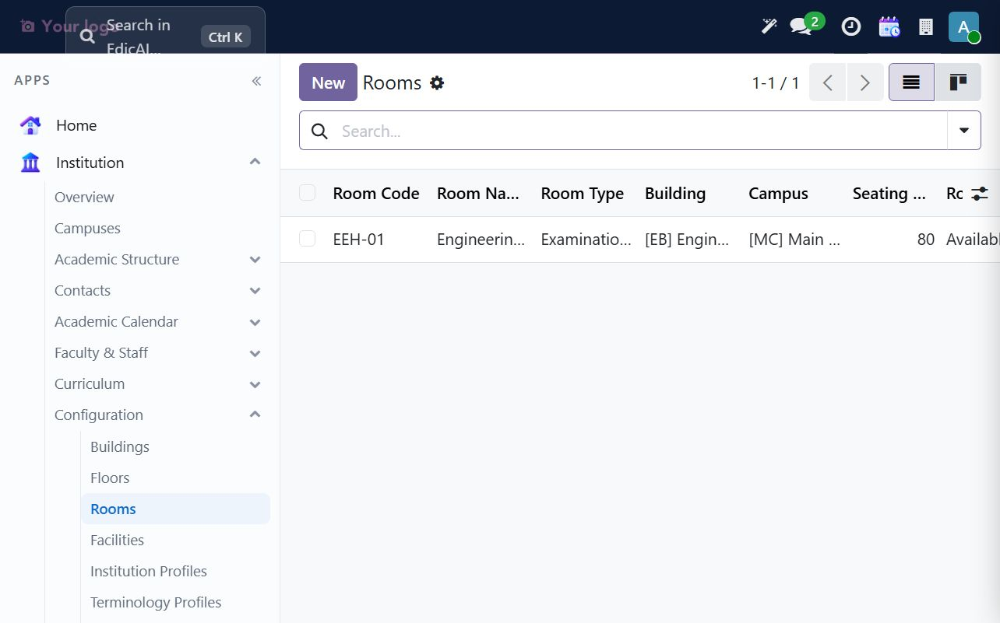
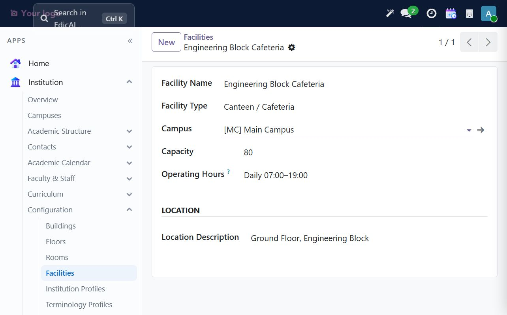
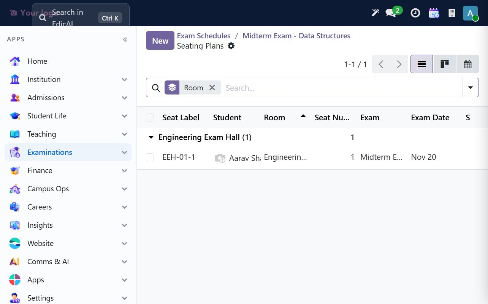
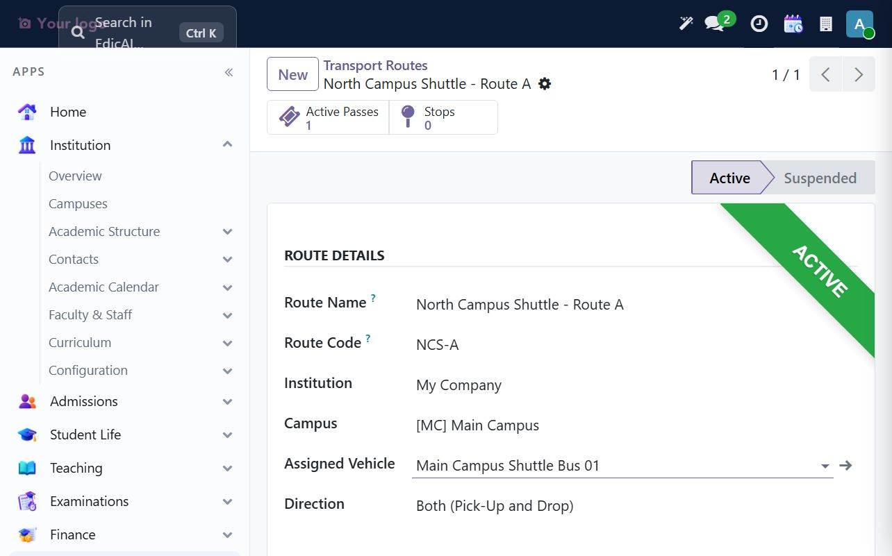
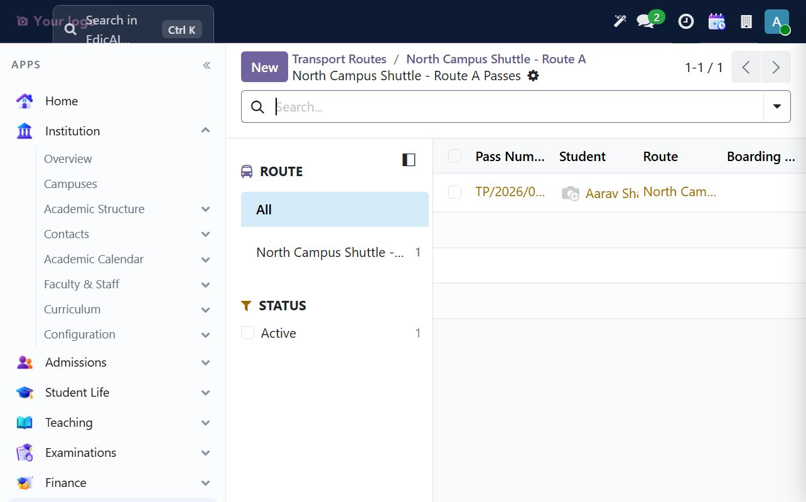
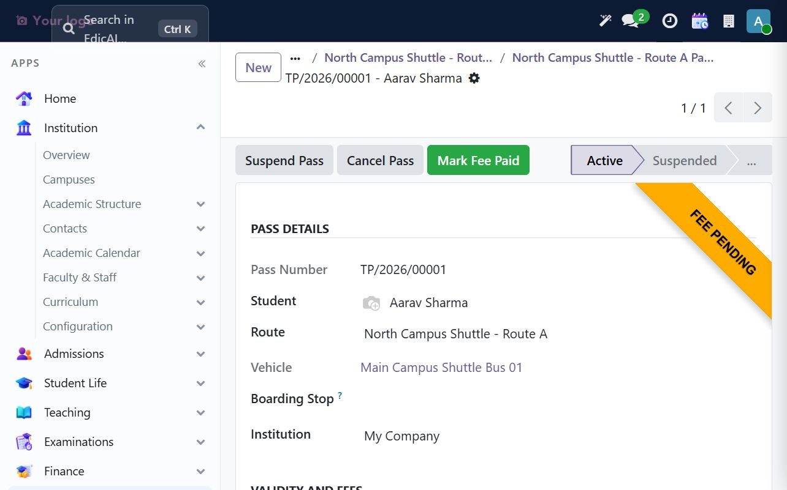
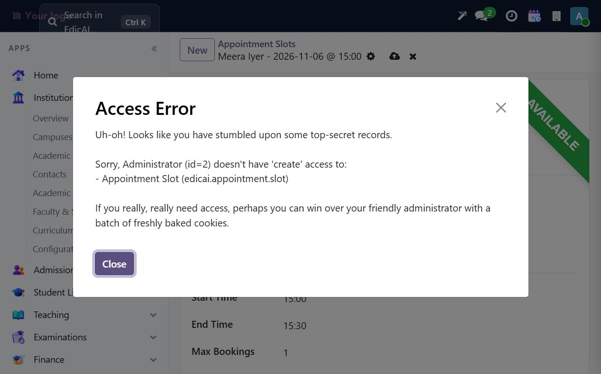

# 9. Campus Ops — Facilities, Transport & Appointments

Campus operations depend on the campus hierarchy established in Act I: **Campus → Building → Floor → Room**. Facilities attach to a campus; transport routes and passes are also scoped to the institution and campus. The examples below use **Main Campus**, **Engineering Block**, **Ground Floor**, **Engineering Exam Hall**, and the student Aarav Sharma.

## 9.1 Buildings, floors, rooms and facilities

Open **Institution → Configuration**. The submenu contains **Buildings**, **Floors**, **Rooms** and **Facilities**. Set up the physical hierarchy before assigning rooms to classes, exams or reservations:

1. Create a building under the correct campus.
2. Add at least one floor under the building.
3. Create rooms by selecting the floor; the building and campus are derived from it.
4. Add campus services such as a cafeteria, gymnasium or medical centre under **Facilities**.

The UAT sample includes `Engineering Block` (code `EB`) on Main Campus, `Ground Floor`, and room `EEH-01` — **Engineering Exam Hall**, capacity 80, status Available.

The campus facility example is **Engineering Block Cafeteria**, capacity 80, operating daily 07:00–19:00, located on the ground floor. Facility type and campus are required; capacity, operating hours and location description help campus staff plan usage.

The same room can be assigned to an exam as a venue. Chapter 8's seating plan shows the room in use and its seat assignment.

## 9.2 Set up fleet and a transport route

Open **Campus Ops → Transport → Vehicles** and create an active vehicle before assigning it to a route. Maintain the registration number, type, seating capacity, campus, driver details and compliance-document expiry dates. The UAT vehicle is `Main Campus Shuttle Bus 01` (`UAT-ED-001`), a 30-seat active bus assigned to Main Campus.

Then open **Campus Ops → Transport → Routes → New**. Select the institution and campus, give the route a unique code, choose the route direction and set its timetable, distance and semester fee. Assign an active vehicle and add route stops when the stop table is available.

The sample route is **North Campus Shuttle - Route A** (`NCS-A`): Main Campus, both pick-up and drop-off, morning departure 07:30/arrival 08:30, evening departure 17:00, 12 km, semester fee **900**. It is active and uses the shuttle bus above. This walkthrough leaves the route's Stops table empty, so the sample pass has no boarding stop; add ordered stop rows and assign a boarding stop before using a route for real riders.

## 9.3 Issue a student transport pass

Open **Campus Ops → Transport → Transport Passes** (the pass register may open with the Active Passes filter). Choose **New**, then select the student and active route. Set the academic year, semester and validity dates; confirm the fee and emergency-contact details before saving.

The UAT pass is `TP/2026/00001` for Aarav Sharma on Route NCS-A, AY 2026-27 / Fall 2026, valid through 12/20/2026, with fee 900 and guardian Rajesh Sharma as the emergency contact.

The sample pass remains **Fee Pending**. Click **Mark Fee Paid** only after payment has actually been received and recorded under the institution's process. The transport pass tracks its own fee-paid flag; do not treat pass activation as proof of payment. **Fee Pending** is available from the Transport menu for follow-up.

## 9.4 Appointments — menu and current UAT access issue

The appointment screens are currently located under **Comms & AI → Appointments → Slots / Bookings**, rather than under Campus Ops. An appointment slot normally needs a faculty member, date, start and end times, and a maximum booking count; bookings are made against an available slot.

During this live walkthrough, saving a valid slot for Meera Iyer returned an **Access Error** saying Administrator (id=2) lacked create access to `edicai.appointment.slot`. No slot or booking was created. The installed appointment-admin ACL is present, so treat this as an access/configuration defect: stop, retain the error details, and ask the product administrator to investigate the effective user permissions. **Do not broaden ACLs or bypass access checks.**

Once the permission issue is resolved through the approved access process, create and publish appointment slots, then use **Bookings** to monitor reservations, capacity and cancellations.

## 9.5 Campus Ops routine

1. Keep campus, building, floor and room records current; set a room to unavailable during maintenance.
2. Review vehicle document expiry and seating capacity before assigning it to an active route.
3. Check **Fee Pending** passes and update payment status only after confirmed payment.
4. Review routes, trip logs and incident reports from the Transport menu.
5. Use the appointment screens only after the access error is resolved; do not work around it by changing security rules.

---

> ✅ **Checklist progress:** Campus Ops now includes a building/floor/room hierarchy, a campus facility, a fleet vehicle, an active route and a sample transport pass. Appointment creation is blocked by the recorded UAT access issue. Next: [Careers — Placement, Alumni & Scholarships](10_careers.md).
