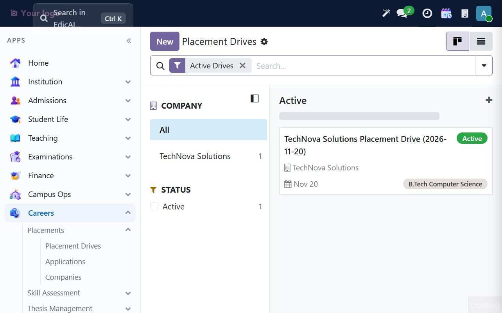
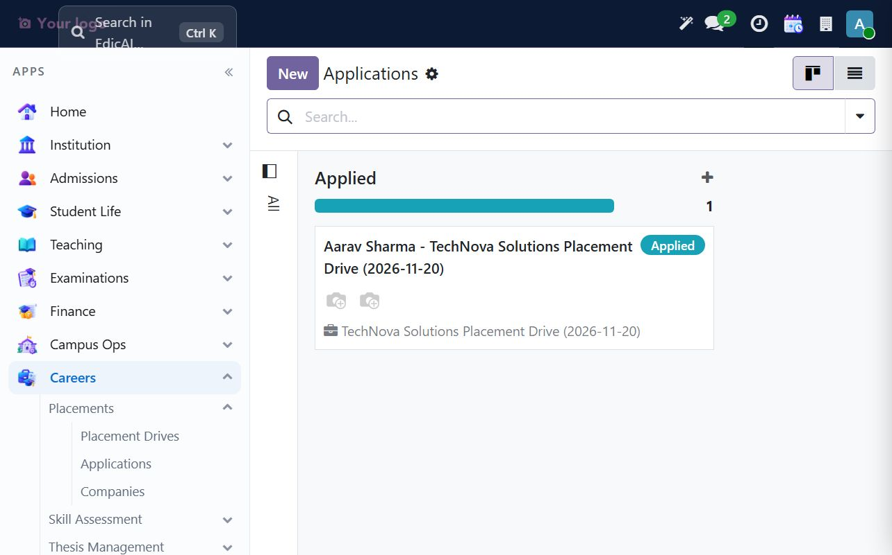
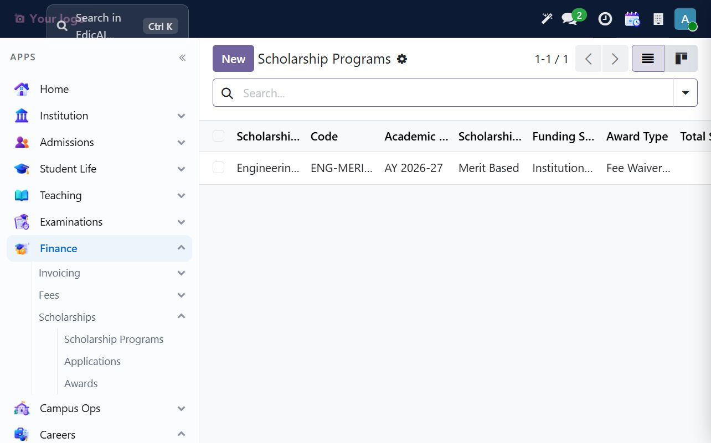
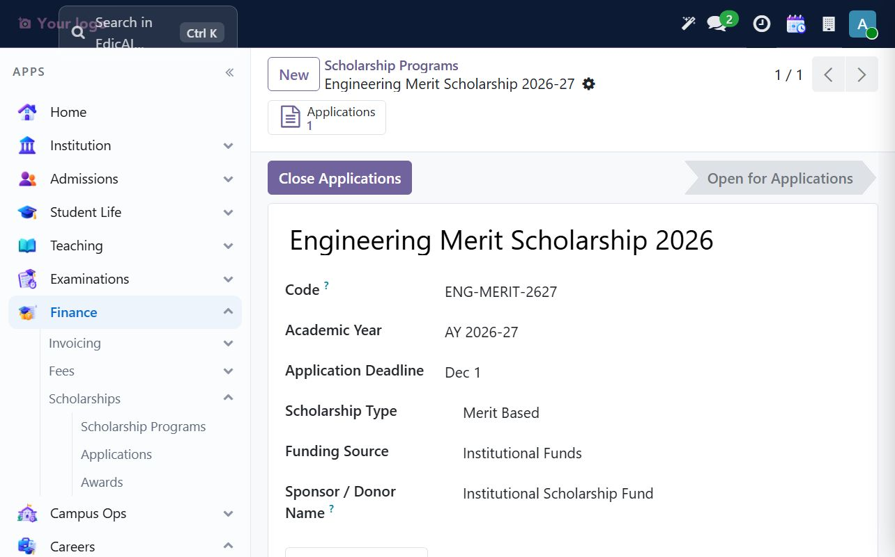
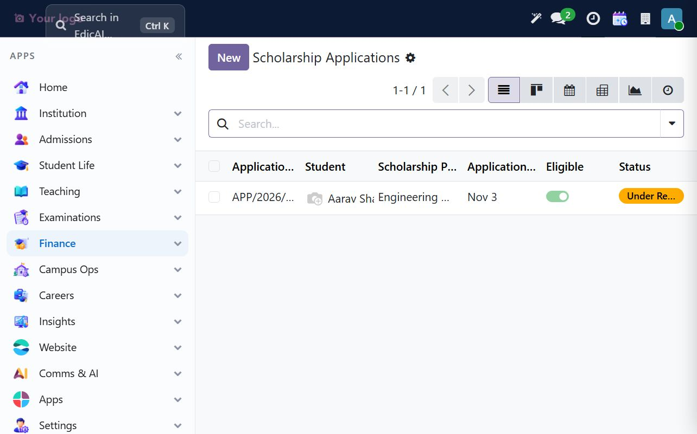
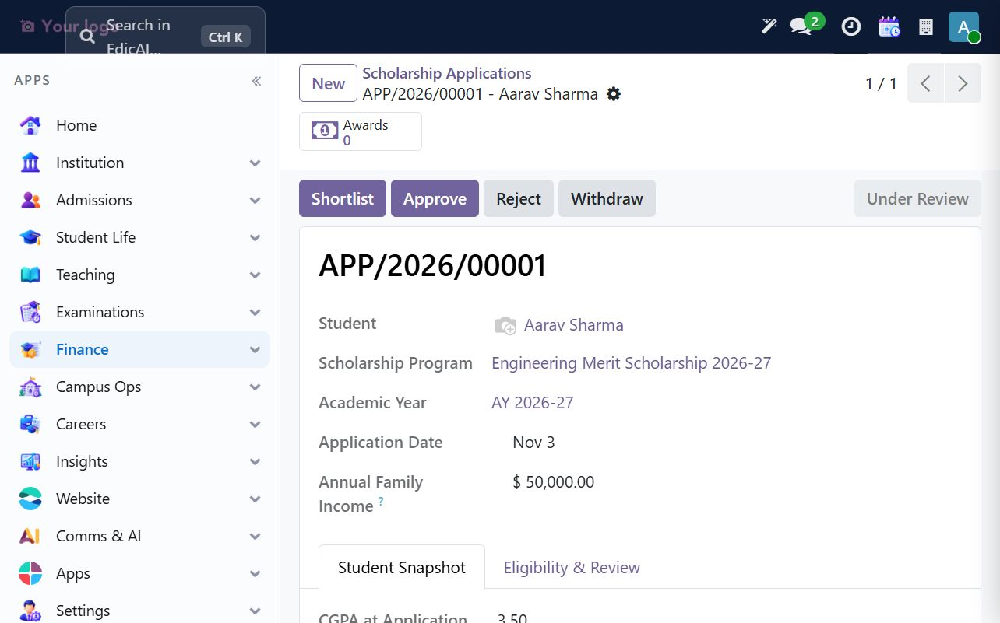

# 10. Careers — Placements, Alumni & Scholarships

The Careers workspace contains placement drives, recruiting companies, student applications, skill assessment, thesis management and events. Scholarship administration is under **Finance → Scholarships** in this build. Alumni support extends the existing student record rather than creating a separate Alumni model.

This walkthrough uses Aarav Sharma, B.Tech Computer Science, AY 2026-27, and recruiting company **TechNova Solutions**.

## 10.1 Create a recruiting company

Open **Careers → Placements → Companies → New**. Enter the company name and industry; add a short description so placement staff can identify the employer in a drive.

The sample employer is **TechNova Solutions**, industry `Software and Engineering`.

## 10.2 Create and open a placement drive

Open **Careers → Placements → Placement Drives → New**. Select the company, set the drive date, and optionally restrict eligible programs. Save the drive as Draft, review the company/date/program scope, then click **Open Drive** before creating applications.

The UAT drive is `TechNova Solutions Placement Drive (2026-11-20)`, open for B.Tech Computer Science.

## 10.3 Register and review an application

Open **Careers → Placements → Applications → New**, select the student and an open drive, then save. The application progresses through **Draft → Submitted → Under Review → Shortlisted / Approved** (or Rejected / Withdrawn).

On **Submit**, Edicai snapshots the student's current CGPA, program, year of study and attendance, then checks the scholarship-independent placement application data. Use **Start Review** to record that a reviewer has taken the application. Shortlisting is blocked for ineligible applications; approval should follow the institution's hiring process.

The example application `APP/2026/00001` is Aarav's application to TechNova. Its current state is **Under Review**; the sample eligibility snapshot is CGPA 3.50 and attendance 100%.

## 10.4 Alumni records and events

The installed Alumni add-on extends **Student** with alumni mailing-list and event-registration links. There is no separate Alumni register in the UAT menus. Keep the graduate's existing student/contact identity; use the student record's **Mailing Lists** and **Events** smart buttons when those relationships exist, with mailing lists managed in Email Marketing and events in Events.

Do not change Aarav to an alumnus: he is an enrolled student in this training database. For a real graduate, update the student lifecycle through the institution's approved graduation process first, then maintain alumni communication/event relationships on that same record.

## 10.5 Configure a scholarship program

Open **Finance → Scholarships → Scholarship Programs → New**. Define the scholarship and its institution/year scope, type and funding source, eligibility criteria, award details, quota and deadline. Save as Draft, review all criteria, and click **Open for Applications** only when the institution is ready to accept submissions.

The sample **Engineering Merit Scholarship 2026-27** (`ENG-MERIT-2627`) is Merit Based, institution-funded, open for AY 2026-27, with a 12/01/2026 deadline, minimum CGPA 3.00, minimum attendance 75%, 10-seat quota, and a $1,000 / 15% fee-waiver benefit.

## 10.6 Receive and review a scholarship application

Open **Finance → Scholarships → Applications → New**, select the student and an open program, enter the requested family-income and supporting statement/achievements, then **Submit**. Submission snapshots the student's CGPA and attendance and stores an eligibility decision with notes. A reviewer can move it to **Under Review**; shortlist/approval should happen only after the institution confirms the evidence.

The sample Aarav application has a $50,000 annual family-income entry, records 3.50 CGPA and 100% attendance at submission, and is marked eligible under the program's minimum criteria. It is **Under Review**, not approved.

## 10.7 Awards and disbursement control

The **Awards** register is for an approved scholarship's actual semester disbursement. It records the application, semester, amount, method (fee adjustment, bank transfer, cheque or cash), date and reference. A fee adjustment can be linked to an outstanding fee invoice.

The sample deliberately has **no award/disbursement record**: the application remains under review. Do not create a disbursement or mark funds as paid before approval and confirmed payment. For fee adjustments, reconcile the award with Finance before changing the fee invoice.

## 10.8 Careers routine

1. Keep company records current and open a drive only after confirming date and eligible-program scope.
2. Review submitted applications; shortlist only eligible candidates and record decisions through the workflow buttons.
3. Maintain alumni relationships on the existing student record; avoid duplicate graduate contacts.
4. Check scholarship eligibility notes and evidence before approval.
5. Record awards only after approval; reconcile any fee adjustment against the fee ledger.

---

> ✅ **Checklist progress:** the walkthrough created an employer, opened a placement drive, moved a student application to review, opened a merit scholarship program and submitted an eligible scholarship application for review. No hiring decision or scholarship payment was fabricated. Next: [Insights — Dashboards & Reports](11_insights.md).
