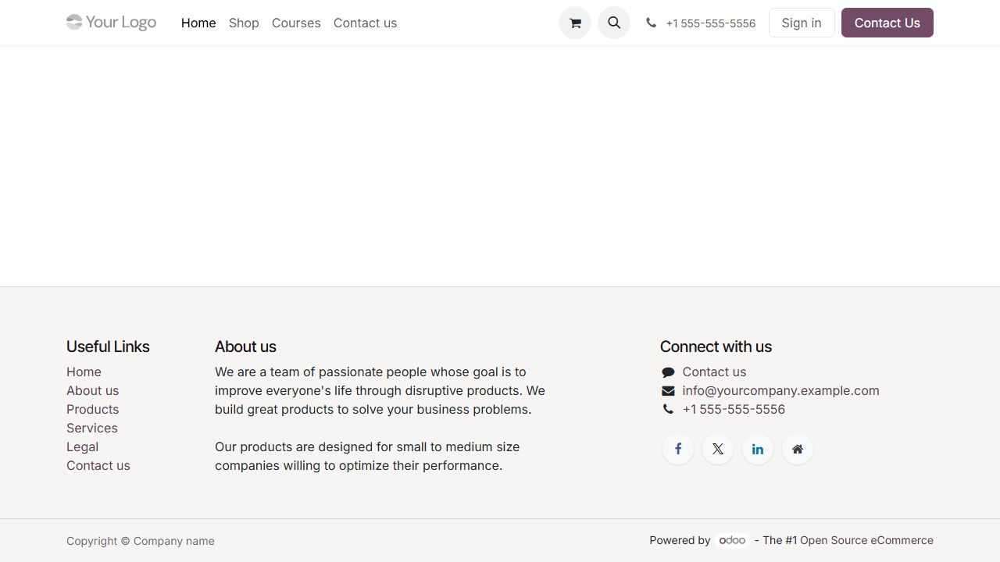
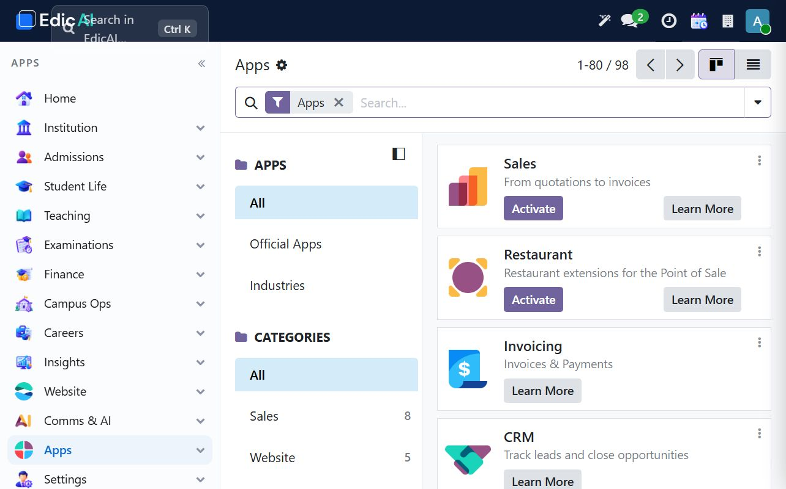

# 13. Website & Apps — Overview

Website and Apps are administrator-controlled areas, not routine operations. The public website is the institution's external face; Apps controls the modules installed in the database. **Review before you change either area.** This chapter documents the safe review workflow observed in UAT. It deliberately does not publish a page, edit products or install a module.

## 13.1 Public website review

Open **Website → Site**. On the UAT site, the menu opens the current homepage. The default page is still the Odoo starter website, showing the institution placeholder **My Website**, a top navigation with Home, Shop, Courses and Contact us, a blank main hero, and footer links for Home, About us, Products, Services, Legal and Contact us.

Before publishing any institution site:

1. Confirm the owning role and who approves public content.
2. Replace placeholder logo, brand name, contacts and social links with verified institution details.
3. Review all page content for admissions, courses, fees, privacy, safeguarding, accessibility and legal notices.
4. Check every outbound link and every form that collects personal data.
5. Preview as a logged-out visitor; do not infer public visibility from the backend.
6. Make only approved changes, and preserve a rollback/backup plan.
7. Re-check navigation, contact details and mobile layout after changes.

The website currently shows commerce/eCommerce elements because `website_sale` is installed. It is not automatically an approved online storefront or admissions portal. Decide whether Shop, Courses and contact forms are in scope; remove or disable them before launch if they are not.

## 13.2 Website administration menu

The UAT **Website** workspace exposes these areas:

| Menu | Use | Safe practice |
|---|---|---|
| Site | Homepage, pages and the Editor | Default content must be replaced and reviewed before going live |
| eCommerce | Products, catalog and online orders | Do not enable until product, payment, delivery, privacy and support owners approve them |
| Reporting | Visitors, sales and website activity | Use for monitoring only; do not share raw visitor data |
| Configuration | Website and shop settings | Change only with a change record and rollback plan |

The pages are public-facing assets even while editing. The **Edit** button affects the site visitors may see; it is not an internal notes area.

## 13.3 Apps: inspect before installing

Open **Apps**. The administrator sees installed applications and the catalogue filtered to `Apps`. It is possible to search module names, open an app card and see whether it is installed or offers **Activate** / **Learn More**.

On the UAT site, **Website** is installed. The eCommerce capability is therefore present even though the institution has not approved a store. Other installed Edicai modules include the website integration, document handling and AI components.

Before installing or upgrading any module:

1. Record the business reason and affected modules.
2. Read the module description and dependencies; confirm it is from the approved Edicai/Odoo source.
3. Check the database backup and migration/rollback plan.
4. Install first in UAT and run the affected workflows: login, menus, access rights, migrations and reports.
5. Check logs for module installation errors and follow the documented support procedure.
6. Do not install similarly named or duplicate modules just to see whether they fix a UI issue.
7. Consider whether the module needs custom code deployment separately from the app catalogue.

## 13.4 Go-live gate for public website and apps

| Check | Pass condition |
|---|---|
| Ownership | Website owner and data/privacy approver named |
| Content | No placeholder text, demo products or fictitious contacts remain |
| Access | Public forms and user accounts respect privacy and safeguarding rules |
| Security | SSL, admin accounts, backups and recovery tested |
| Integration | Email, payment, admissions and document flows tested in UAT |
| Rollback | Previous version and database backup available |
| Monitoring | Post-launch visits, errors and failed forms are monitored |

## 13.5 Administrator routine

1. Review the homepage and key pages after each content or module change.
2. Verify contact details, deadlines, fee notices and legal text with the institution.
3. Review Apps after vendor updates; do not install unknown modules.
4. Audit website forms and eCommerce orders; disable unused modules if they create risk.
5. Keep screenshots and a change log for public-content releases.

---

> ✅ **Checklist progress:** reviewed the UAT public site and installed Apps modules. No website page was changed and no module was installed. The homepage remains an unapproved default template. Next: [Quick Reference Cheat Sheet](14_quick_reference.md).
